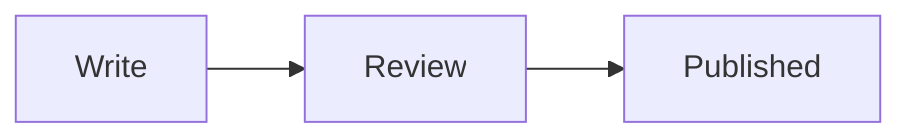

# Publish a post

This repository publishes posts on percona.com/blog. Employees and community authors publish through a pull request. After review the post is merged and published automatically.

You already have a finished post, for example in a Google Doc, a docx file, a PDF, or Markdown. Ask your AI agent, or prepare the pull request yourself. The pull request adds the post to this repository as Markdown. You also need an author profile. Check the post locally with `make -C tools serve` before you ask for review.

## Author profile

Create `authors/<id>/index.md` if you do not already have one. Look at the other authors in `authors/`.

The `id` is the folder name. Use lowercase letters, digits, and hyphens: `name-surname`, for example `pablo-svampa`. The same string is the public address, `/author/name-surname/`.

Use a hyphen. These are rejected:

- `name_surname`
- `name.surname`
- `Name-Surname`

`name` is the display name, for example `Pablo Svampa`. Set `type` to `staff` or `community`. Fill `role`, `company`, `github`, and `linkedin` when you have them. Put the portrait in the same folder and set `image` to the filename, for example `avatar.jpg`. The text under the front matter is the public bio.

In a post, list this `id` under `authors`. Do not write the display name there.

## Create a post

1. Branch from `main`.
2. Add the post as `posts/<year>/slug/index.md`. Copy `tools/archetypes/blog.md`. A post with no images can be a single file, `posts/<year>/slug.md`. Do not put a date in the filename. The publication date is written when the post is published.
3. Set `id` once, to the original filename without `.md`: `mysql-connection-pool`. Do not change it later. That filename is the public address, `/blog/mysql-connection-pool/`. Set `slug` only when the public address should differ. Renaming the file is safe while `id` stays. Changing `id` makes a new post.
4. Set `authors` to one or more author ids. Set `origin` to `percona` or `community`. A `percona` post can list only `staff` authors. Set `categories` to names from `tools/data/wp-categories.txt`. A missing name needs an issue, not a new spelling.
5. Open a pull request. `make -C tools check` must pass. The post is merged when it has an approve from 3 experts. The publish build then sets `date` to the time that build succeeds and the post goes out. The date you typed is only for the preview. A later edit does not move the publication date.

`draft: true` keeps the post off the published feed and off the main site. The pull request preview still includes it, the same way `make -C tools serve` does. To take a published post down, set `draft: true` and keep the file. Deleting the file leaves the published post up.

## Review

Ask experts to read the pull request. **View deployment** opens the built site. They can also run `make -C tools serve` and open the post. The post is merged only after 3 experts approve it. One or two approvals are not enough. The same rule applies to a pull request that edits a published post.

A post sometimes gets no reviewers, or a reviewer declines it. That happens. It means this post did not catch interest. Close it and try a different one.

## Images

If the post has images, keep it as a folder. Put `index.md` and the image files side by side. In the text, use the filename:

```markdown

```

The first name under `images` is the cover. Every post needs one, at 1200×630 pixels, the Open Graph size. Make it yourself if you know how it should look. If you do not, say so in the pull request and we will make it. The build does not resize other pictures. The article column is 855px wide, so about 1600px wide is enough. Use JPEG or WebP for photos, and PNG or WebP for screenshots and diagrams. Aim for about 200–400 KB per file. A file of 3–4 MB is too heavy. An author portrait is square, about 400px, shown at 96px.

For a diagram, use a Mermaid block instead of a screenshot. The preview draws it.

````markdown

````

## Edit a post

For about three days after publication, open a pull request with the change. Say which post and what should change.

After about three days the published text may already have been edited, and a change in git will not replace it. Do not keep pushing edits. Open an issue, name the post, and describe the change you want.

## Front matter

```yaml
title: "Post title"
id: post-title
date: 2026-11-10T09:00:00-08:00
draft: false
origin: percona
description: "One or two sentences. This is the summary on the blog."
authors:
  - name-surname
categories:
  - MySQL
tags:
  - Performance
images:
  - diagram.png
```

`description` is optional. Without it, the summary is the first paragraph. A date without a time is midnight in `America/Los_Angeles`.

## Look at it on your machine

After cloning, from this repository:

```bash
make -C tools serve
```

Open http://localhost:1314/ . That server includes drafts. Before the pull request, run `make -C tools check`.
