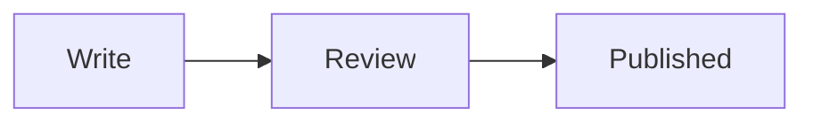

# percona/blog demo

This repository publishes posts on percona.com/blog. Employees and community authors can publish. A post is submitted as a pull request and goes through review. After review it is merged and published automatically.

## How to publish a post

1. You already have a finished post, for example in a Google Doc, a docx file, a PDF, or Markdown.
2. Ask your AI agent, or prepare the pull request yourself. The pull request adds the post to this repository as Markdown. Notes for an agent are in [AGENTS.md](AGENTS.md).
3. Create the post file in `posts/<year>/slug.md`. Copy `tools/archetypes/blog.md`. The filename is the public address, `/blog/slug/`. Do not put a date in the filename.
4. Put images in the same folder as the post. When the post has images, use `posts/<year>/slug/index.md` and place the image files next to it. In the text, link the filename, for example `diagram.png`. The first name in `images` is the cover, 1200×630.
5. Check that your author profile exists, or create `authors/<id>/index.md`. Look at the other authors in `authors/`. The `id` is the folder name, `name-surname`, and the post lists that id under `authors`.

## Examples

Finished posts are in [`posts/`](posts/). Author profiles are in [`authors/`](authors/).

[Semantic search on PostgreSQL, part 1](posts/2026/semantic-search-on-postgresql-part-1/index.md) includes a Mermaid diagram. The field list is in [CONTRIBUTING.md](CONTRIBUTING.md).

## Review

Review starts when the pull request is open. Ask reviewers to read that pull request. The post is merged only after 3 experts approve it. One or two approvals are not enough. The same rule applies to an edit of a published post.

A pull request with no reviewers, or one that is declined, did not catch interest. Close it and try a different post.

## When it is published

The post is published automatically after the merge. The publication date is the time that build finishes. It is not the date in the filename, and it is not the date you typed for the preview. A later edit does not move that date.

The `feed` branch is written by that build. It holds the published files. Do not commit to it, and do not open a pull request against it. The next build replaces the branch.

For about three days after publication, a change still goes through a new pull request. After about three days, do not expect a git edit to replace the published text. Open an issue, name the post, and describe the change.

## Preview

After the pull request is open, a comment links to a temporary copy of the site. That copy includes drafts. Render deletes it when the pull request is merged or closed.

To preview on your computer you need [Hugo](https://gohugo.io/) 0.168.

```bash
git clone https://github.com/dbazhenov/percona-test-blog-repo.git
cd percona-test-blog-repo
make -C tools serve
```

Open http://localhost:1314/ . This preview includes drafts. `make -C tools preview` builds the HTML without drafts.

## Check for mistakes

Before you ask for review, from the repository root:

```bash
make -C tools check
```

The check fails when an author page is missing, an author id is malformed, a category is not in `tools/data/wp-categories.txt`, or an image is named in the post but the file is not next to it. It does not judge the writing or the file size. Look at the preview, and check that each image is about 200–400 KB. A file of 3–4 MB is too heavy.

`draft: true` keeps the post off the published feed. Locally it is still visible with `make -C tools serve`.

## Images

Every post needs a cover, 1200×630 pixels. That is the Open Graph size used when the post is shared. The cover is the first name in `images`. Make it yourself if you know how it should look. If you do not, say so in the pull request and we will make it.

Other pictures in the post sit next to `index.md`. The build does not resize them. The article column is 855px wide, so about 1600px wide is enough. Use JPEG or WebP for photos, and PNG or WebP for screenshots and diagrams. Aim for about 200–400 KB per file. A file of 3–4 MB is too heavy.

An author portrait is a square file next to `authors/<id>/index.md`, named in `image`. It is shown at 96px. A square of about 400px is enough.

## Diagrams

For a diagram, use a Mermaid block instead of a screenshot. The preview draws it.

````markdown

````
