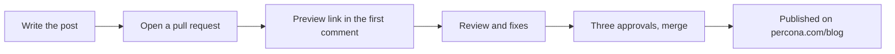

# Percona Blog

This repository is the new way to publish posts on [percona.com/blog](https://www.percona.com/blog/). A post is a Markdown file. You add it here in a pull request, people who know the subject review it, and after the merge it is published on the blog automatically. Nobody needs the WordPress editor or the admin panel.

Perconians and community authors publish the same way. The community blog at percona.community will be merged into percona.com/blog and closed, so community posts come here too.

## Start with the examples

Four example posts show the whole thing. Each one is also a guide.

| Example | For | What is in it |
| --- | --- | --- |
| [How a Perconian publishes a post](https://apps.percona.community/new-wordpress-blog/how-a-perconian-publishes/) ([source](posts/2026/how-a-perconian-publishes/index.md)) | Perconians | The whole process: the post file, front matter, categories and tags, the preview, review, changing a published post, and every formatting element. |
| [Your first community post, from a fork](https://apps.percona.community/new-wordpress-blog/community-post-from-a-fork/) ([source](posts/2026/community-post-from-a-fork/index.md)) | Community authors | Forking the repository, an SSH key, cloning, branches, pushing, and how an AI agent can do most of it. Written for people new to Git. |
| [Example post](https://apps.percona.community/new-wordpress-blog/example-post/) ([source](posts/2026/example-post/index.md)) | Everyone | A short tour of the Markdown a post can use: headings, lists, a table, code, a diagram, images. |
| [Demo pull request](https://github.com/dbazhenov/percona-test-blog-repo/pull/6) | Everyone | A post pull request that stays open on purpose: the preview comment, the checks, and the files a first post adds. |

## How it works

1. Write the post wherever you like: Google Docs, Word, or straight in Markdown.
2. Open a pull request with the post, yourself or with an AI agent.
3. The first comment on the pull request links to a preview of the post.
4. Reviewers leave comments. You push fixes to the same branch, and the preview updates.
5. After three approvals the pull request is merged.
6. The post is sent to WordPress and published on percona.com/blog.



## Perconians and community authors

| | Perconians | Community authors |
| --- | --- | --- |
| Where you work | In this repository, on a branch. The Perconians group has access. | In your own fork of this repository. |
| Branch name | `blog/<post-id>` | `blog/<post-id>`, in your fork |
| Front matter | `origin: percona` | `origin: community` |
| Author page | `type: staff` | `type: community` |
| Start with | [How a Perconian publishes a post](posts/2026/how-a-perconian-publishes/index.md) | [Your first community post, from a fork](posts/2026/community-post-from-a-fork/index.md) |

Everything else is the same: the files, the review, the preview, and the publishing.

## With an AI agent

The easiest way is to give your agent a link to this repository and your draft:

> Here is how to publish on the Percona blog: https://github.com/dbazhenov/percona-test-blog-repo. Help me publish my draft from ~/Downloads/post.docx.

Cursor, Claude Code, and similar agents read [AGENTS.md](AGENTS.md) (Claude Code through [CLAUDE.md](CLAUDE.md)). It tells them where the files go, which rules to follow, and what not to touch. They prepare the post and the pull request; people still review and merge it.

## Review and publishing

- A post is merged after **three approvals** from people who know the subject. If you know them, ask them to review. If not, wait: the blog team finds reviewers.
- If nobody picks a post up, or a reviewer declines it, close the pull request and try another post.
- After the merge, the post is published automatically. The publication date is set at that moment. It is not the date in the file.
- For the first few days after publication, a fix to the post goes through a new pull request, on a branch named `fix/<post-id>`.
- After that, the blog team may polish the post in WordPress, and the repository no longer updates it. To change it, [open an issue](https://github.com/dbazhenov/percona-test-blog-repo/issues/new).

## For the blog team

- **Review** happens in pull requests. The preview link is in the first comment. Approve with a review, not with a comment.
- **Merge** after three approvals. Publishing starts on its own; watch it in [Actions → Feed](https://github.com/dbazhenov/percona-test-blog-repo/actions/workflows/feed.yml).
- **Publish again by hand** from Actions → Feed → Run workflow, for example after a direct fix on `main`. A plain push to `main` does not publish.
- **Stop updates from git** for a post you edited in WordPress: open it in the editor and check *Block updates from git*. Later changes in the repository will not overwrite it.
- **Categories** come from [`tools/data/wp-categories.txt`](tools/data/wp-categories.txt). A new category has to exist in WordPress first, then be added there.

## What is in this repository

| Path | What it holds |
| --- | --- |
| [`posts/`](posts/) | The posts, one folder per post: `posts/<year>/<post-id>/index.md` with its pictures next to it. |
| [`authors/`](authors/) | Author pages: `authors/<name-surname>/index.md` with a square portrait. |
| [`CONTRIBUTING.md`](CONTRIBUTING.md) | All the rules for a post in one place: fields, categories, tags, images, checks. |
| [`AGENTS.md`](AGENTS.md) | Instructions for AI agents. |
| `tools/` | The build and the preview. Authors do not need to touch it. |
| `.github/` | The workflows that check, preview, and publish. |

## Preview on your computer

The pull request preview is enough for most authors. To see a post before you open a pull request, install [Hugo](https://gohugo.io/) 0.168 or newer and Python 3, then from the repository folder:

```bash
make -C tools serve    # preview at http://localhost:1314/ , drafts included
make -C tools check    # the same check the pull request runs
```
