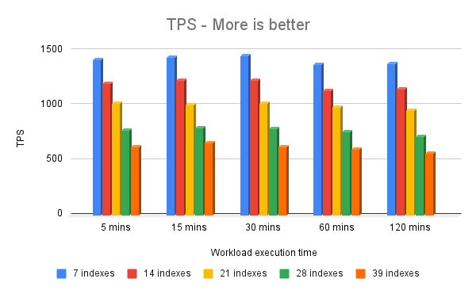
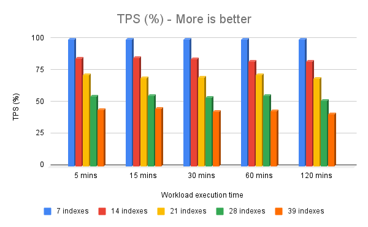
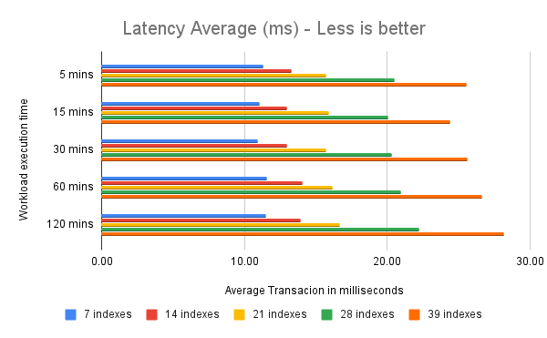
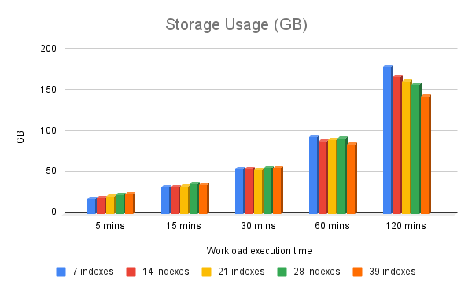
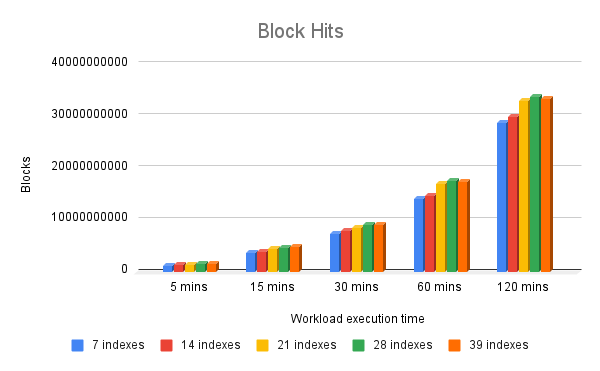
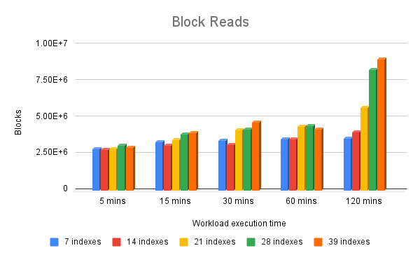
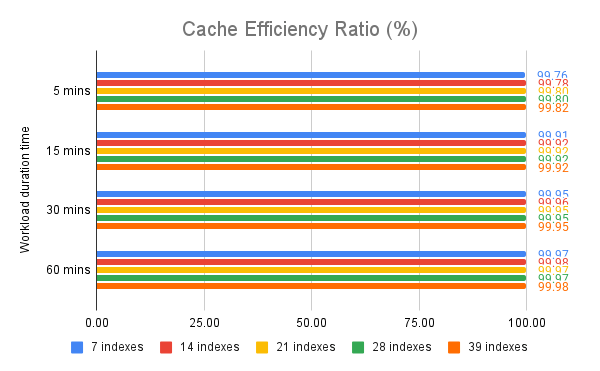

Indexing is one of PostgreSQL’s most effective tools for improving query performance, but like any powerful tool, it can cause real problems when overused.

A while ago, my colleague [Jobin](https://www.percona.com/blog/author/jobin-augustine/) wrote a blog post exploring the negative side effects of over-indexing in PostgreSQL: [PostgreSQL Indexes Can Hurt Performance: Exploring the Negative Effects and the Costs Involved](https://www.percona.com/blog/postgresql-indexes-can-hurt-you-negative-effects-and-the-costs-involved/). It was a solid write-up from a theoretical standpoint, and it raised important points that often go unnoticed in day-to-day database work.

This time, I wanted to take things a step further. While theory is valuable, numbers often speak louder and can help you decide whether it’s worth going the extra mile to revisit your schema. I designed a series of tests for benchmarking PostgreSQL to get a clearer picture of how over-indexing impacts performance under a bit more meaningful workloads than what pgbench can provide.

### About the setup

The testing environment was no toy setup; all benchmarks were executed on a high-performance server:

- Dell PowerEdge C6525

- 2 physical CPUs, 64 cores each (128 virtual cores) — AMD EPYC 7452 32-core Processors

- 1 TiB of DDR4 RAM

- Red Hat Enterprise Linux 9.4 (Plow)

- PostgreSQL 17.4
    - The PostgreSQL custom settings we used
        ```
        effective_cache_size = '128GB'
        checkpoint_timeout = '30min'
        shared_preload_libraries = 'pg_stat_statements'
        pg_stat_statements.track = 'all'
        pg_stat_statements.max = '10000'
        track_io_timing = 'on'
        max_connections = '200'
        maintenance_work_mem = '2GB'
        bgwriter_lru_maxpages = '500'
        max_wal_size = '200GB'
        min_wal_size = '50GB'
        log_autovacuum_min_duration = '60000'
        shared_buffers = '64GB'
        ```

### About the methodology

A detailed and repeatable benchmark methodology was designed to thoroughly evaluate the impact of over-indexing. The goal was to eliminate noise and bottlenecks, ensuring that performance degradation could be reliably attributed to index overhead rather than data variation or system inconsistencies.

- The data schema was designed to include multiple tables, a variety of data types, and integrity constraints.

- A data loading script was designed to populate the tables with hundreds of millions of random tuples, resulting in an initial dataset of approximately 11 GB. After benchmark execution, the dataset grows to a net size of around 200GB.

- To ensure consistency across test runs, a dump was generated after the initial data load. This dump was used to recreate the database before each test round, guaranteeing not only the same initial data volume but also identical data content.

- Finally, a custom transaction script was developed to mimic a real application workload. This script executed a mix of `INSERT`, `UPDATE`, `SELECT` operations. The workload was executed by [`pgbench`](https://www.postgresql.org/docs/17/pgbench.html) simulating concurrent users for various durations (5, 15, 30, 60, and 120 minutes), and was repeated across scenarios with 7, 14, 21, 28, and 39 indexes applied.

- The dataset size was designed to fit into memory (or FS cache) as much as possible, avoiding any potential IO bottleneck.

- Resetting bgwriter metrics for better accuracy while collecting results.

- Restarting the database right before starting each of the test rounds, ensuring to release cached data.

In other words, everything was designed to avoid any noise from any side effect while maximizing the evidence from the over-indexing.

You can find all the related scripts in the following GitHub repository: [https://github.com/psvampa/postgresql_benchmarking_overindexing](https://github.com/psvampa/postgresql_benchmarking_overindexing)

### Benchmark results



Benchmark results show a clear correlation between index count and performance: TPS dropped consistently from ~1400 to ~600 as the number of indexes increased from 7 to 39.



In other words, increasing the number of indexes from 7 to 39 reduced performance to approximately 42% of the original throughput. This clearly highlights the inverse relationship between index count and performance in our benchmark.



Since our benchmark rounds were executed based on fixed time windows (per round), the total number of TPS per test is closely tied to the speed of each individual transaction; the faster a transaction completes, the more transactions can be performed within the same time window.

Our benchmark shows that when running with 7 indexes (across the entire schema), the average transaction time was 11 ms. On the other end of the spectrum, the schema with 39 indexes resulted in an average transaction time of 26 ms.



Since our workflow continuously performs INSERTs and UPDATEs across the schema’s tables, observing a growth pattern in storage consumption is expected, and that is precisely what we see. Understanding the storage growth pattern and the associated costs of database datasets and their backups reinforces the need for proper data retention policies to control long-term growth.


It may seem counterintuitive that storage usage decreased as the number of indexes increased in the final test round (the 120-minute run), unlike the earlier rounds. This represents a clear inflection point in the benchmark. Since the tests were executed over a fixed time window, the overhead introduced by additional indexes resulted in fewer transactions being completed. Consequently, fewer rows were inserted and updated, and the total data volume decreased in the test cases with higher index counts. Because all indexes were single-column and table tuples generally require more storage, the reduced number of DML operations ultimately led to lower overall space consumption.







The three charts above illustrate the I/O demands observed both in PostgreSQL’s cache (`shared_buffers`) and in the I/O subsystem (whether through the filesystem cache or directly from physical disks).

As shown, the PostgreSQL cache hit ratio in our benchmark consistently remained above 99.7%, which is no coincidence. Our initial dataset, the test rounds, the amount of memory available on the server, and the PostgreSQL configuration parameters were all carefully designed to minimize potential bottlenecks, such as reads or writes hitting physical storage. Instead, the metrics clearly show that, for the majority of the time, data was served directly from PostgreSQL’s cache.

### Conclusions on benchmarking PostgreSQL

This benchmark does NOT aim to evaluate PostgreSQL’s transactional capabilities, nor is it intended to discourage the use of indexes that can provide performance benefits to the application. The advantages of indexing are well known and extensively documented.

Instead, this benchmark aims to demonstrate the negative impact of over-indexing or holding UNUSED indexes during data modification operations (INSERT, UPDATE, DELETE). These UNUSED indexes provide no benefits and also introduce measurable performance degradation.

This setup allowed for meaningful apples-to-apples comparisons where performance deviations could be attributed mainly to the indexing overhead. The results show that while indexes might be essential for performance, excessive or unnecessary indexing can significantly degrade write throughput and transactional performance, sometimes in ways that aren’t immediately obvious until you measure them under pressure.

This benchmark also intends to serve as a practical reference for developers, DBAs, and architects who want to weigh the trade-offs of aggressive indexing in PostgreSQL. It’s not about dropping indexes but about choosing which ones truly add value.

Finally, note that these results reflect the performance degradation caused by over-indexing in a fully controlled environment, where all variables and configurations were carefully tuned to isolate and demonstrate the impact of excessive indexing.

In a production environment, you will rarely encounter such favorable conditions; your application may introduce concurrency issues, your dataset may not fit entirely in memory, and your cache hit ratio may be significantly lower, all of which will amplify the performance loss.

Therefore, this benchmark only provides a practical frame of reference for what theory already suggests.

You’ve chosen PostgreSQL for its flexibility, performance, and cost savings—but even experienced IT leaders can hit avoidable pitfalls along the way. Here’s what to look out for.

[Enterprise PostgreSQL Buyer’s Guide](https://hubs.ly/Q03j7mwt0)
