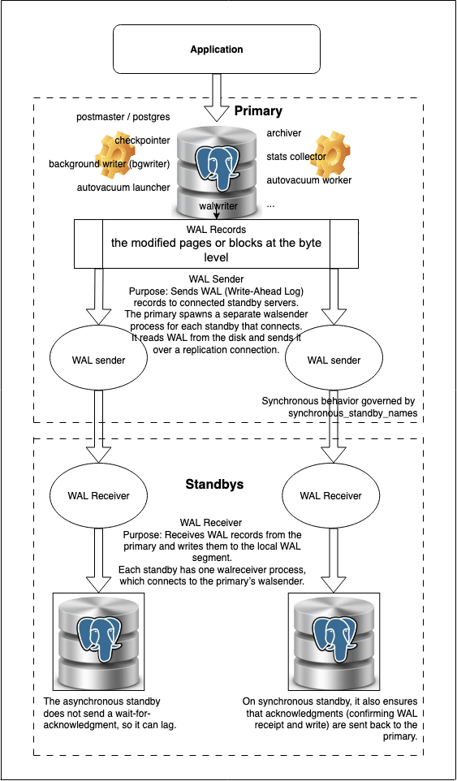

PostgreSQL streaming replication allows a standby server to continuously replicate data from a primary server. It operates by streaming Write-Ahead Log (WAL) segments from a primary server to one or more standby (replica) servers. The WAL segments contain a record of all changes made to the database, including data modifications and schema alterations (specifically, the modified pages or blocks at the byte level). When these WAL segments are replayed on the standby, it ensures that the standby maintains an identical copy of the primary’s data and schema. This means that a standby always reflects the exact state of the primary at the point in time of the last replayed WAL segment.

## There are two primary modes of PostgreSQL streaming replication:

Asynchronous replication: In asynchronous replication, the primary server sends WAL segments to the standby servers and immediately continues processing transactions without waiting for confirmation that the standby has received or applied the changes. This mode offers the lowest latency on the primary, as it doesn’t incur the overhead of waiting for replica acknowledgement. However, it introduces a potential for data loss in the event of a primary server failure. If the primary crashes before the standby has fully replayed all received WAL segments, any unapplied transactions on the standby will be lost. This is often an acceptable trade-off for applications that prioritize write performance over strict data consistency in disaster scenarios.

Synchronous replication: In contrast, synchronous replication ensures that a transaction on the primary is not considered committed until it has been confirmed as written to disk on at least one standby server. This provides a higher level of data integrity, as it guarantees that no data is lost even if the primary server fails. The primary waits for an acknowledgement from the standby that the WAL segment containing the transaction has been safely received and written. While synchronous replication offers strong consistency, it introduces increased latency on the primary server because it must wait for the network round-trip and disk write on the standby. This mode is typically chosen for applications where data consistency and zero data loss are paramount, even at the cost of slightly reduced write performance.

## Streaming replication architecture

The following diagram illustrates the architecture of PostgreSQL streaming replication, where a primary server streams WAL (Write-Ahead Log) records to one or more standby servers. WAL sender processes on the primary push changes to standby nodes, which have corresponding WAL receiver processes.



## Server IP mapping

These IP addresses identify the primary and replica nodes used in the PostgreSQL streaming replication setup.

```
172.31.19.120 : ArunPostgresPrimary
172.31.17.175 : ArunPostgresReplica1
172.31.16.41  : ArunPostgresReplica2Sync
```

## Install PostgreSQL server on three servers

Begin by installing PostgreSQL on all three servers — one primary and two replicas. Use the following command:

```
root@ArunPostgresPrimary:/home/ubuntu# apt install postgresql
Reading package lists... Done
Building dependency tree... Done
Reading state information... Done
The following additional packages will be installed:
  libcommon-sense-perl libjson-perl libjson-xs-perl libllvm17t64 libpq5 libtypes-serialiser-perl postgresql-16 postgresql-client-16 postgresql-client-common postgresql-common ssl-cert
Suggested packages:
  postgresql-doc postgresql-doc-16
The following NEW packages will be installed:
  libcommon-sense-perl libjson-perl libjson-xs-perl libllvm17t64 libpq5 libtypes-serialiser-perl postgresql postgresql-16 postgresql-client-16 postgresql-client-common postgresql-common ssl-cert
0 upgraded, 12 newly installed, 0 to remove and 0 not upgraded.
Need to get 43.6 MB of archives.
After this operation, 175 MB of additional disk space will be used.
Do you want to continue? [Y/n] y
```

This installs the default PostgreSQL version (e.g., 16), along with required dependencies like the PostgreSQL client, server binaries, and SSL certificates.

### Verify PostgreSQL installation

Run the following command to confirm PostgreSQL and its components are installed:

```
root@ArunPostgresPrimary:/home/ubuntu# apt list --installed | grep postgres

WARNING: apt does not have a stable CLI interface. Use with caution in scripts.

postgresql-16/noble-updates,noble-security,now 16.9-0ubuntu0.24.04.1 amd64 [installed,automatic]
postgresql-client-16/noble-updates,noble-security,now 16.9-0ubuntu0.24.04.1 amd64 [installed,automatic]
postgresql-client-common/noble-updates,now 257build1.1 all [installed,automatic]
postgresql-common/noble-updates,now 257build1.1 all [installed,automatic]
postgresql/noble-updates,now 16+257build1.1 all [installed]
root@ArunPostgresPrimary:/home/ubuntu#

root@ArunPostgresPrimary:/home/ubuntu# psql --version
psql (PostgreSQL) 16.9 (Ubuntu 16.9-0ubuntu0.24.04.1)
root@ArunPostgresPrimary:/home/ubuntu#
```

This lists the installed PostgreSQL server (postgresql-16), client tools, and common packages, verifying that version 16.9 is correctly set up on the system.

Repeat these steps on all three servers to ensure a consistent setup for replication.

## Configure primary PostgreSQL server

To configure the primary PostgreSQL server for replication, you need to update certain settings that allow it to support and communicate with standby replicas.

### Step 1: Update the postgresql.conf file on the primary server to enable replication:

These settings ensure the primary is ready to serve one or more standby nodes

```
# Enable WAL level to 'replica' or 'logical' (replica sufficient for streaming)
wal_level = replica

# Set max number of replication connections
max_wal_senders = 10

# How many WAL files to keep for standby (optional but recommended)
wal_keep_size = 512MB

# Enable hot standby to allow read queries on standby (optional, but useful)
# Note: This is primarily for standby but can be set here for clarity
hot_standby = on
```

Although wal_level = replica, hot_standby = on, max_wal_senders = 10, and synchronous_commit = on are set to their default values, we will explicitly define them in postgresql.conf for clarity. Additionally, we need to update wal_keep_size = ‘512MB’ and listen_addresses = ‘*’ as they are not set by default.

```
root@ArunPostgresPrimary:/home/ubuntu# cat /etc/postgresql/16/main/postgresql.conf |egrep -i 'wal_level|wal_keep_size|max_wal_senders|hot_standby|synchronous_commit|listen_addresses|synchronous_standby_names'
listen_addresses = '*'		# what IP address(es) to listen on;
wal_level = replica			# minimal, replica, or logical
synchronous_commit = on		# synchronization level;
max_wal_senders = 10		# max number of walsender processes
wal_keep_size = '512MB'		# in megabytes; 0 disables
#max_slot_wal_keep_size = -1	# in megabytes; -1 disables
synchronous_standby_names = ''	# standby servers that provide sync rep
hot_standby = on			# "off" disallows queries during recovery
#hot_standby_feedback = off		# send info from standby to prevent
root@ArunPostgresPrimary:/home/ubuntu#
```

Setting listen_addresses = ‘*’ allows PostgreSQL to accept connections from any IP address, which is convenient in flexible or dynamic environments but may pose a security risk. Limiting access is safer and more secure if you know the specific replica IPs that will connect.

In this test setup, I set wal_keep_size = 512MB as a safe default, and you should consider increasing it if your replicas experience lag or frequent disconnections. Alternatively, if the replica is expected to be down for an extended period, enable WAL archiving by setting archive_mode = on. This allows PostgreSQL to archive WAL files using the specified archive_command, ensuring the replica can catch up later.

```
root@ArunPostgresPrimary:/home/ubuntu# sudo systemctl restart postgresql
root@ArunPostgresPrimary:/home/ubuntu#
```

We can restart PostgreSQL after editing pg_hba.conf to allow replication connections from the replica. However, to reflect the current configuration changes, we’re restarting it here as well and will see the details.

```
postgres@ArunPostgresPrimary:~$ psql -c "SHOW listen_addresses; SHOW wal_level; SHOW wal_keep_size; SHOW max_wal_senders; SHOW hot_standby; SHOW synchronous_commit;"
 listen_addresses
------------------
 *
(1 row)

 wal_level
-----------
 replica
(1 row)

 wal_keep_size
---------------
 512MB
(1 row)

 max_wal_senders
-----------------
 10
(1 row)

 hot_standby
-------------
 on
(1 row)

 synchronous_commit
--------------------
 on
(1 row)

postgres@ArunPostgresPrimary:~$
```

### Step 2: Edit pg_hba.conf on the primary to allow connections from the replica:

In the pg_hba.conf file on the primary server, we’ve added two entries to allow replication connections. The first entry permits the asynchronous replica to connect, while the second enables the synchronous replica. These rules authenticate the replicator user using MD5 over the specified IPs.

```
postgres@ArunPostgresPrimary:/home/ubuntu$ tail -6 /etc/postgresql/16/main/pg_hba.conf
# Allow replica to connect for replication
host    replication     replicator     172.31.17.175/32     md5

# Allow replica2
host    replication     replicator     172.31.16.41/32     md5
```

172.31.17.175 and 172.31.16.41 represent the IP addresses of the replica servers in the setup.

If you forget to add the required entries in the pg_hba.conf file on the primary server and then reload or restart PostgreSQL, any replica trying to initiate a replication connection will be denied access. You’ll encounter an error like the one below when running pg_basebackup from the replica:

```
pg_basebackup: error: connection to server at "172.31.19.120", port 5432 failed: FATAL:  no pg_hba.conf entry for replication connection from host "172.31.17.175", user "replicator", SSL encryption
connection to server at "172.31.19.120", port 5432 failed: FATAL:  no pg_hba.conf entry for replication connection from host "172.31.17.175", user "replicator", no encryption
```

### Step 3: Restart PostgreSQL on the primary server to apply changes:

```
root@ArunPostgresPrimary:/home/ubuntu# sudo systemctl restart  postgresql
root@ArunPostgresPrimary:/home/ubuntu#
```

You can verify if the pg_hba.conf entries for a replication user like replicator are correctly loaded by querying the pg_hba_file_rules system view:

```
postgres=# x
Expanded display is on.
postgres=# SELECT * FROM pg_hba_file_rules
WHERE 'replicator' = ANY(user_name);
-[ RECORD 1 ]------------------------------------
rule_number | 8
file_name   | /etc/postgresql/16/main/pg_hba.conf
line_number | 134
type        | host
database    | {replication}
user_name   | {replicator}
address     | 172.31.17.175
netmask     | 255.255.255.255
auth_method | md5
options     |
error       |
-[ RECORD 2 ]------------------------------------
rule_number | 9
file_name   | /etc/postgresql/16/main/pg_hba.conf
line_number | 137
type        | host
database    | {replication}
user_name   | {replicator}
address     | 172.31.16.41
netmask     | 255.255.255.255
auth_method | md5
options     |
error       |

postgres=#
```

This confirms that the PostgreSQL server recognises the rules allowing replication connections from specific IP addresses (172.31.17.175 and 172.31.16.41 in this case) using MD5 authentication. The line_number and file_name help trace the rule’s exact location in the configuration file.

### Step 4. Create a PostgreSQL replication user on the primary:

To enable streaming replication, a dedicated user with replication privileges is required. On the primary server, switch to the postgres user and run the following SQL command inside psql:

```
root@ArunPostgresPrimary:/home/ubuntu# sudo su postgres
postgres@ArunPostgresPrimary:/home/ubuntu$
```

```
postgres@ArunPostgresPrimary:/home/ubuntu$ psql -U postgres
psql (16.9 (Ubuntu 16.9-0ubuntu0.24.04.1))
Type "help" for help.

postgres=#

postgres=# CREATE ROLE replicator WITH REPLICATION LOGIN PASSWORD 'amma';
CREATE ROLE
postgres=#
```

This creates a user named replicator with permission to connect and replicate data from the primary. The LOGIN attribute allows the user to authenticate, and the REPLICATION attribute grants the necessary rights for streaming replication. Make sure the same credentials are used in the replica’s primary_conninfo.

## Configure the asynchronous replication:

To set up asynchronous replication, the replica must start with a fresh copy of the primary’s data. The following steps guide you through stopping the replica server, clearing its existing data, and syncing it with the primary.

### Step 1. Stop PostgreSQL on the replica server:

Shut down the PostgreSQL service to safely clear and repopulate the data directory:

```
root@ArunPostgresReplica1:/home/ubuntu# sudo systemctl stop postgresql
root@ArunPostgresReplica1:/home/ubuntu#
```

### Step 2. Clear the existing data directory

Remove all files from the replica’s data directory to ensure a clean base for replication:

```
root@ArunPostgresReplica1:/home/ubuntu# sudo rm -rf /var/lib/postgresql/16/main/*
root@ArunPostgresReplica1:/home/ubuntu#
root@ArunPostgresReplica1:/home/ubuntu# ls -ltr /var/lib/postgresql/16/main/
total 0
root@ArunPostgresReplica1:/home/ubuntu#
```

### Step 3. Clone the primary using pg_basebackup

Use pg_basebackup to copy the database contents from the primary server:

```
root@ArunPostgresReplica1:/home/ubuntu# sudo -u postgres pg_basebackup -h 172.31.19.120 -D /var/lib/postgresql/16/main -U replicator -P -R
Password:
23158/23158 kB (100%), 1/1 tablespace
root@ArunPostgresReplica1:/home/ubuntu#
```

-h: Specifies the IP address of the primary.

-D: Destination directory for the backup.

-U: Replication user.

-P: Shows progress.

-R: Automatically configures the replica (primary_conninfo and standby.signal).

### Step 4: Start the replica and verify replication

Start the PostgreSQL service on the replica server:

```
root@ArunPostgresReplica1:/home/ubuntu# sudo systemctl start postgresql
root@ArunPostgresReplica1:/home/ubuntu#
```

### Step 5: Confirm replica is in recovery mode

Switch to the postgres user and connect to the database to confirm it’s running in standby (read-only) mode:

```
root@ArunPostgresReplica1:/home/ubuntu# su postgres
postgres@ArunPostgresReplica1:/home/ubuntu$

postgres@ArunPostgresReplica1:/home/ubuntu$  psql -U postgres
psql (16.9 (Ubuntu 16.9-0ubuntu0.24.04.1))
Type "help" for help.

postgres=#
```

The server is a standby/replica replaying WAL (in recovery). The result is t, it confirms the server is in recovery mode and actively replicating from the primary.

```
postgres=# SELECT pg_is_in_recovery();
 pg_is_in_recovery
-------------------
 t
(1 row)

postgres=#
```

### Step 6: Verify replication from the primary

On the Primary server, run:

```
postgres=# SELECT
    pid,
    client_addr,
    state,
    sync_state,
    application_name
FROM pg_stat_replication;
  pid   |  client_addr  |   state   | sync_state | application_name
--------+---------------+-----------+------------+------------------
 158312 | 172.31.17.175 | streaming | async      | 16/main
(1 row)
```

This confirms that:

- The replica at 172.31.17.175 is connected and streaming WAL data.

- The sync_state is async, indicating asynchronous replication is active.

The application_name reflects how the replica was identified in primary_conninfo. The application_name is not explicitly set in the replica’s primary_conninfo, PostgreSQL defaults to using the replica’s data directory path—like 16/main—as the name shown in pg_stat_replication. To make monitoring clearer, especially with multiple replicas, it’s best to set a meaningful application_name (e.g., replica1) in the primary_conninfo string. After restarting the replica, this name will appear on the primary when checking replication status.

### Step 7: Update application_name on the replica:

To explicitly set application_name, follow the steps below. This can be done using the ALTER SYSTEM command. After updating and restarting PostgreSQL, the replica will show up in pg_stat_replication with the custom name (e.g., replica1), helping clearly identify and manage multiple replicas.

# Do not edit this file manually!

```
root@ArunPostgresReplica1:/home/ubuntu# cat /var/lib/postgresql/16/main/postgresql.auto.conf
# Do not edit this file manually!
# It will be overwritten by the ALTER SYSTEM command.
primary_conninfo = 'user=replicator password=amma channel_binding=prefer host=172.31.19.120 port=5432 sslmode=prefer sslcompression=0 sslcertmode=allow sslsni=1 ssl_min_protocol_version=TLSv1.2 gssencmode=prefer krbsrvname=postgres gssdelegation=0 target_session_attrs=any load_balance_hosts=disable'
root@ArunPostgresReplica1:/home/ubuntu#
```

1. Connect as Postgres user. Switch to the postgres user to run database-level commands. This ensures appropriate permissions for modifying the configuration.

```
ubuntu@ArunPostgresReplica1:~$ sudo su
root@ArunPostgresReplica1:/home/ubuntu# su postgres
postgres@ArunPostgresReplica1:/home/ubuntu$  psql -U postgres
psql (16.9 (Ubuntu 16.9-0ubuntu0.24.04.1))
Type "help" for help.
```

1. 1. Update primary_conninfo with application_name

Using ALTER SYSTEM updates the postgresql.auto.conf safely without manual editing. The application_name=replica1 clearly labels this replica for the primary server’s monitoring.

```
postgres=# ALTER SYSTEM SET primary_conninfo =
  'user=replicator password=amma host=172.31.19.120 port=5432 sslmode=prefer application_name=replica1';
ALTER SYSTEM
postgres=#
```

3. Verify Updated Configuration

```
root@ArunPostgresReplica1:/home/ubuntu# cat /var/lib/postgresql/16/main/postgresql.auto.conf
# Do not edit this file manually!
# It will be overwritten by the ALTER SYSTEM command.
primary_conninfo = 'user=replicator password=amma host=172.31.19.120 port=5432 sslmode=prefer application_name=replica1'
root@ArunPostgresReplica1:/home/ubuntu#
```

1. 1. Restart PostgreSQL Service

A restart is necessary for the changes in postgresql.auto.conf to take effect and re-establish streaming replication with the new identity.

```
root@ArunPostgresReplica1:/home/ubuntu# sudo systemctl restart postgresql
root@ArunPostgresReplica1:/home/ubuntu#
```

1. 1. Confirm on Primary Server

You should now see the replica listed with the specified application_name (e.g., replica1), which makes it easier to distinguish among multiple replicas.

```
postgres=# SELECT client_addr, application_name FROM pg_stat_replication;
  client_addr  | application_name
---------------+------------------
 172.31.17.175 | replica1
(1 row)

postgres=#
```

## Configure the synchronous replication:

Before configuring synchronous replication, ensure that basic streaming replication is already set up and functioning. The following steps build on that foundation to enable synchronous behavior between the primary and replica.

### Step 1: Set up basic streaming replication (already done)

Follow the same steps we did for the asynchronous replica to set up the synchronous replica.

Verify that asynchronous replication is already working between the primary and the replica using the following query on the primary server.

```
postgres=# SELECT
    pid,
    client_addr,
    state,
    sync_state,
    application_name
FROM pg_stat_replication;
  pid   |  client_addr  |   state   | sync_state | application_name
--------+---------------+-----------+------------+------------------
 158312 | 172.31.17.175 | streaming | async      | replica1
 158313 | 172.31.16.41  | streaming | async      | 16/main
```

### Step 2: Update application_name on the synchronous replication:

Just like in asynchronous replication, we must set application_name in primary_conninfo. But in synchronous replication, it’s critical because:

- The synchronous_standby_names setting on the primary uses the application_name to identify which standby is considered synchronous.

- If the application_name does not match, the primary will not recognise the replica as a [synchronous standby](https://www.percona.com/blog/postgresql-synchronous_commit-options-and-synchronous-standby-replication/), defeating the purpose of synchronous replication.

Setting application_name correctly ensures the standby is recognised and used for synchronous commit behaviour. Without it, replication may silently fall back to asynchronous.

```
root@ArunPostgresReplica2Sync:/home/ubuntu# cat /var/lib/postgresql/16/main/postgresql.auto.conf
# Do not edit this file manually!
# It will be overwritten by the ALTER SYSTEM command.
primary_conninfo = 'user=replicator password=amma channel_binding=prefer host=172.31.19.120 port=5432 sslmode=prefer sslcompression=0 sslcertmode=allow sslsni=1 ssl_min_protocol_version=TLSv1.2 gssencmode=prefer krbsrvname=postgres gssdelegation=0 target_session_attrs=any load_balance_hosts=disable'
root@ArunPostgresReplica2Sync:/home/ubuntu#
```

Using ALTER SYSTEM updates the postgresql.auto.conf safely without manual editing. The application_name=replica2Sync clearly labels this replica for the primary server’s monitoring.

```
postgres=# ALTER SYSTEM SET primary_conninfo =
  'user=replicator password=amma host=172.31.19.120 port=5432 sslmode=prefer application_name=replica2Sync';
ALTER SYSTEM
postgres=#

root@ArunPostgresReplica2Sync:/home/ubuntu# cat /var/lib/postgresql/16/main/postgresql.auto.conf
# Do not edit this file manually!
# It will be overwritten by the ALTER SYSTEM command.
primary_conninfo = 'user=replicator password=amma host=172.31.19.120 port=5432 sslmode=prefer application_name=replica2Sync'
root@ArunPostgresReplica2Sync:/home/ubuntu#
```

### Step 3: Enable synchronous replication on the primary

Set synchronous_standby_names on the primary to tell PostgreSQL which standby (by its application_name) must acknowledge commits before they’re considered durable.

```
root@ArunPostgresPrimary:/home/ubuntu# grep -i synchronous_standby_names /etc/postgresql/16/main/postgresql.conf
synchronous_standby_names = '1 (replica2Sync)'  # standby servers that provide sync rep
root@ArunPostgresPrimary:/home/ubuntu#
```

1. After updating this setting on the primary, you must restart PostgreSQL to apply it

```
root@ArunPostgresPrimary:/home/ubuntu# sudo systemctl restart postgresql
root@ArunPostgresPrimary:/home/ubuntu#
```

‘1 (replica2Sync)’ means: wait for acknowledgment from 1 synchronous standby named replica2Sync. replica2Sync is the application_name set in the replica’s primary_conninfo.

2. As we changed the replica’s primary_conninfo (to set application_name=replica2Sync), restart the replica as well so it reconnects with the new identity.

```
root@ArunPostgresReplica2Sync:/home/ubuntu# sudo systemctl restart postgresql
root@ArunPostgresReplica2Sync:/home/ubuntu#
```

3. Verify replication mode

Run the following query on the primary:

```
postgres=# SELECT
    pid,
    client_addr,
    state,
    sync_state,
    application_name
FROM pg_stat_replication;
  pid   |  client_addr  |   state   | sync_state | application_name
--------+---------------+-----------+------------+------------------
 158312 | 172.31.17.175 | streaming | async      | replica1
 159249 | 172.31.16.41  | streaming | sync       | replica2Sync
(2 rows)
```

This confirms that replica1 is operating in asynchronous mode, meaning the primary does not wait for it to acknowledge writes. On the other hand, replica2Sync is correctly identified as the synchronous standby, so the primary waits for its acknowledgement before finalising transactions, ensuring data consistency in real time.

1. 1. Monitor the real-time replication lag from primary server

The following command continuously monitors the replication lag (in readable size) and state of connected replicas from the primary server, refreshing every 1 second.

```
postgres@ArunPostgresPrimary:/home/ubuntu$ watch -n 1 "psql -c "SELECT client_addr, state,sync_state, pg_size_pretty(pg_wal_lsn_diff(sent_lsn, replay_lsn)) AS lag FROM pg_stat_replication;""

Every 1.0s: psql -c "SELECT client_addr, state,sync_state, pg_size_pretty(pg_wal_lsn_diff(sent_lsn, replay_lsn)) AS lag FROM pg_stat_replication;"         ArunPostgresPrimary: Sun Jul 20 15:00:51 2025

  client_addr  |   state   | sync_state |   lag
---------------+-----------+------------+---------
 172.31.17.175 | streaming | async      | 0 bytes
 172.31.16.41  | streaming | sync       | 0 bytes
(2 rows)
```

The output confirms that both replicas — one asynchronous and one synchronous — are actively streaming from the primary server with zero replication lag. The sync_state column clearly shows their roles, and the lag being 0 bytes indicates real-time synchronization. This continuous monitoring approach ensures your PostgreSQL replication setup remains healthy, up-to-date, and ready for high availability needs.


