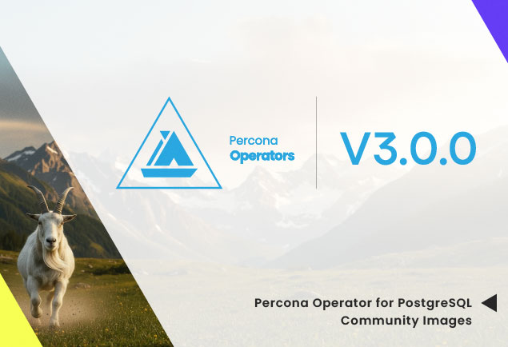
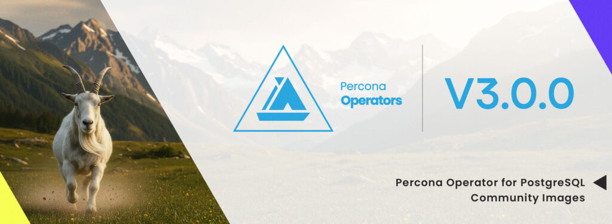

PostgreSQL community images address a real gap in how a Kubernetes database operator earns your trust. Running a database operator on Kubernetes means trusting two things: the code, and the container images the operator pulls. The code is on GitHub, easy to inspect, easy to fork. The container images, the registry that hosts them, and the license that governs them all sit with the vendor, and any of those three can change without the source repository changing at all. Starting with Percona Operator for PostgreSQL 3.0.0, you can run the operator against community images you build yourself from the official PostgreSQL packages on download.postgresql.org, in a registry you control.

## TL;DR

- Community Docker Images: tech preview in PGO 3.0.0, official in 3.1.0. Point the operator at upstream-built PostgreSQL images instead of the Percona Distribution images.
- Build them yourself from the official PostgreSQL source. The Dockerfiles pull packages from download.postgresql.org (the PGDG repositories), so the trust chain runs from PGDG to your registry with no vendor in the middle.
- There are limits. Anything Percona-specific (TDE in our distribution build, for example) does not exist in an upstream-built image. That trade is intentional.

In this post:

- How open source gets diluted in practice
- Why distributions exist anyway, honestly
- How Community Docker Images work
- Limits of the upstream path
- What to try, what to tell us

## How open source gets diluted

Open source has changed in the last few years, and not always for the better. Companies have learned that you can keep a project’s source code fully open and still capture most of the lock-in by quietly closing the parts that matter in production: the release artifacts, the container images, the supported OS list, the certified Kubernetes distributions, the marketplace listings.

### Same project, closed artifacts

You can have a fully community CNCF project that does not appear on the Red Hat Marketplace except as a paid Enterprise edition. Similarly, you can have a vendor that ships one packaging in the community and a richer one in Enterprise with the features you actually need in production. The license still says “open source.” The practical experience says “you depend on us.” And the source repository’s license is not the only license that matters here: a vendor can change the license, the trademark policy, or the distribution terms on the container images alone, while leaving the source repository untouched. That has happened in the PostgreSQL operator space recently, and the community noticed.

### Why the community is right to be wary

Nobody outside the vendor can predict when a license will change, when a feature will move behind a paywall, or when an external contribution will get rejected because it competes with an Enterprise feature. Recent history has plenty of examples and the PostgreSQL community has been paying attention. When this community resists vendor-controlled distributions, it is not nostalgia. It is a rational read of where things have gone before.

I work on Percona’s PostgreSQL operator, so I see this conversation from the vendor side. The skepticism is fair. The honest question for us is what to do about it.

## Why distributions exist anyway

Acknowledging the community’s concerns does not mean distributions are pointless. There are real reasons to ship one, and pretending otherwise makes for bad blog posts.

### What a distribution buys you

A vendor-built distribution lets the vendor:

1. Control the build process, dependencies, and defaults so they fit a specific user shape.
2. Ship hotfixes faster, because the whole release path sits in one place.
3. Fork PostgreSQL itself when something the upstream community will not accept, or can take years to accept, matters to customers, such as Transparent Data Encryption.
4. For a Kubernetes operator, ship images with exactly the tools and extensions the operator supports, and skip everything else. The CVE surface stays smaller.
5. Give QA and Service teams a predictable environment. “We support extensions A, B, C and not D, X, Z” is only honest if QA actually exercises A, B, C and the Service team can work with them in the production environment.
6. Give customers one accountable party for the full release cycle, from hotfix through package availability. Some teams explicitly need that contract for compliance and audit reasons.
7. And yes, less positive reasons that we covered above also apply, which is exactly the part the community keeps pointing at.

### The trade-off you accept

If you run the vendor distribution, you accept that the vendor’s registry, image policy, and supported-extension matrix become part of your stack. If the vendor changes any of that, your operator deployment changes with it. That is not hypothetical for users who have lived through it on other products.

So the real question is whether you can keep the benefits a distribution provides for the users who want them, while leaving an honest, supported door open for users who do not. That is the door PGO 3.0.0 opens.

## Community PostgreSQL Images in PGO 3.0.0

Starting with Percona Operator for PostgreSQL 3.0.0, the operator can run against images built from upstream PostgreSQL packages, not just the Percona Distribution images. This is what we are calling Community PostgreSQL Images. In 3.0.0, the feature ships as a tech preview. In 3.1.0, these images become part of our official release cycle and are fully documented.

One of the main advantages of Community Docker Images is that the community can request or contribute any extension that does not exist in the official Percona PostgreSQL distribution. TimescaleDB and Citus are the first examples: the community asked for them, and we shipped both in the Community Images set from day one.

## How to use “Community PostgreSQL images”

The operator does not care where the image came from, as long as the image meets the operator’s runtime expectations

A typical CR using a community image looks like this:

```
apiVersion: pgv2.percona.com/v2
kind: PerconaPGCluster
metadata:
  name: cluster1
spec:
  image: registry.example.com/postgresql-community:18
  postgresVersion: 18
  proxy:
    pgBouncer:
      image: registry.example.com/pgbouncer-community:1.23
  backups:
    pgbackrest:
      image: registry.example.com/pgbackrest-community:2.51
  # other spec fields unchanged from a normal CR
```

The fields that change are spec.image, spec.proxy.pgBouncer.image, and spec.backups.pgbackrest.image. You can build and publish all three images under your own registry, with your own tags if that helps you track versions. The operator drives the rest of the deployment the same way it always has: instances, backups, replication, monitoring, all of it.

### What ships are in each image

Each Community Docker Image is a thin layer over the chosen base (UBI9 or UBI8) plus the packages the operator needs for that role. Where you see {N}, substitute the PostgreSQL major you build for (17, 18, and so on).

`postgres` image (e.g. `postgres17`):

<table>
<thead>
<tr>
<th>Package</th>
<th>Role</th>
</tr>
</thead>
<tbody>
<tr>
<td><code>postgresql{N}-server</code></td>
<td>PostgreSQL server</td>
</tr>
<tr>
<td><code>postgresql{N}-contrib</code></td>
<td>contrib modules</td>
</tr>
<tr>
<td><code>pg_repack_{N}</code></td>
<td>online table/index reorganization</td>
</tr>
<tr>
<td><code>pgaudit_{N}</code></td>
<td>audit logging</td>
</tr>
<tr>
<td><code>set_user_{N}</code></td>
<td>privilege escalation control</td>
</tr>
<tr>
<td><code>pgvector_{N}</code></td>
<td>vector similarity search</td>
</tr>
<tr>
<td><code>wal2json_{N}</code></td>
<td>WAL to JSON logical decoding</td>
</tr>
<tr>
<td><code>pg_cron_{N}</code></td>
<td>in-database cron scheduler</td>
</tr>
<tr>
<td><code>pgbackrest&amp;lt;/code&gt;</code></td>
<td>backup/restore tool</td>
</tr>
<tr>
<td><code>patroni</code></td>
<td>HA cluster manager</td>
</tr>
<tr>
<td><code>timescaledb-2-postgresql-{N}</code></td>
<td>time-series extension (x86_64 only; EL9 only for PG18)</td>
</tr>
<tr>
<td><code>citus_{N}</code></td>
<td>distributed PostgreSQL (PG16+ only)</td>
</tr>
</tbody>
</table>

`pgbackrest` image:

<table>
<thead>
<tr>
<th>Package</th>
<th>Role</th>
</tr>
</thead>
<tbody>
<tr>
<td><code>pgbackrest</code></td>
<td>backup/restore tool only</td>
</tr>
</tbody>
</table>

`pgbouncer` image:

<table>
<thead>
<tr>
<th>Package</th>
<th>Role</th>
</tr>
</thead>
<tbody>
<tr>
<td><code>pgbouncer</code></td>
<td>connection pooler only</td>
</tr>
</tbody>
</table>

The split is intentional. The postgres image ships the full operator-aware runtime. The backup and proxy images stay minimal. As a result, the operator’s components are in separate failure domains and shrink the attack surface of each container.

### Limits worth being honest about

A community image is not a Percona Distribution image. Two practical consequences:

- Distribution-only features will not work. Transparent Data Encryption, for example, lives in the Percona Distribution build. A community image built from upstream PostgreSQL does not include it. If you depend on TDE, run the distribution image.
- Support boundaries are different. Percona Support is responsible for the Percona Distribution images and the operator code. A community image you built yourself

Ultimately, these are the right trade-offs. The point of community images is to give you transparency and control. Taking care of your own image is part of that deal. At the same time, we publish all three images under perconalab/percona-postgresql-operator on Docker Hub so you can evaluate the tech preview without standing up your own build pipeline first. perconalab is Percona’s non-production namespace, so use those images for testing. For production, build and sign your own.

UBI9 (EL9):

```
docker.io/perconalab/percona-postgresql-operator:main-postgres14-community
docker.io/perconalab/percona-postgresql-operator:main-postgres15-community
docker.io/perconalab/percona-postgresql-operator:main-postgres16-community
docker.io/perconalab/percona-postgresql-operator:main-postgres17-community
docker.io/perconalab/percona-postgresql-operator:main-postgres18-community
docker.io/perconalab/percona-postgresql-operator:main-pgbackrest-community
docker.io/perconalab/percona-postgresql-operator:main-pgbouncer-community
docker.io/perconalab/percona-postgresql-operator:main-upgrade-community
```

UBI8 (EL8):

```
docker.io/perconalab/percona-postgresql-operator:main-ubi8-postgres14-community
docker.io/perconalab/percona-postgresql-operator:main-ubi8-postgres15-community
docker.io/perconalab/percona-postgresql-operator:main-ubi8-postgres16-community
docker.io/perconalab/percona-postgresql-operator:main-ubi8-postgres17-community
docker.io/perconalab/percona-postgresql-operator:main-ubi8-postgres18-community
docker.io/perconalab/percona-postgresql-operator:main-ubi8-upgrade-community
```

### How to build the images

The Dockerfile, the package list, and a sample CI job ship in [percona-docker/postgresql-containers/community.](https://github.com/percona/percona-docker/tree/main/postgresql-containers/community) The build is a regular make target on top of docker buildx, so you can run it on any multi-platform builder.

```
# Prerequisites: docker buildx with a multi-platform builder
docker buildx create --use --name multiarch

# Build and push all PostgreSQL community images (UBI9 / EL9)
git clone https://github.com/percona/percona-docker
cd percona-docker/postgresql-containers/community
make all TAG=1.0.0 REGISTRY=myrepo/percona-postgresql-operator

# Or a single image
make postgres17 TAG=1.0.0 REGISTRY=myrepo/percona-postgresql-operator

# UBI8 / EL8 variants
make all-ubi8 TAG=1.0.0-ubi8 REGISTRY=myrepo/percona-postgresql-operator
```

make all builds all three images (postgres, pgBouncer, pgBackRest) so they stay version-aligned. Override REGISTRY and TAG to point at your own namespace and tagging scheme. Once the images are in your registry, plug them into the CR fields shown earlier, and the operator picks them up.

Full build documentation: [percona-docker/postgresql-containers/community/README.md.](https://github.com/percona/percona-docker/blob/main/postgresql-containers/community/README.md)

### How to contribute

Community images live in [percona/percona-docker](https://github.com/percona/percona-docker), and the build is driven by a transform.py generator that produces the Dockerfiles under build/. The files under build/ are regenerated on every sync, so contributions go through the generator, never through the generated files.

Full contribution guide: [community/CONTRIBUTING.md](https://github.com/percona/percona-docker/blob/main/postgresql-containers/community/CONTRIBUTING.md).

### How to provide feedback

Two channels, depending on the shape of the feedback:

- GitHub issue on [percona/percona-postgresql-operator](https://github.com/percona/percona-postgresql-operator) with the community-images label. Use this for bug reports, missing extensions, build problems, and concrete requests. The label keeps all community-image reports in one filter the team watches.

## What’s next

The first step was taking full engineering ownership of Percona Operator for PostgreSQL as an independent project, so the roadmap, the release cadence, and the governance live with one team that the community can talk to directly. Community PostgreSQL Images are the next step in that same commitment. If the community adopts this path, we have ideas for what to invest in next.

We will let the community tell us. If this is useful, we keep investing here. We are ready to add more features to the operator around Community Images. Conversely, if nobody adopts it, that is also a signal, and an honest one.

Try the tech preview in 3.0.0. Open an issue if the build flow is rougher than it should be. Tell us what you want next on the forum or directly on GitHub.

## Try It Out

- Percona Operator for PostgreSQL docs: [https://docs.percona.com/percona-operator-for-postgresql/](https://docs.percona.com/percona-operator-for-postgresql/)
- GitHub: [https://github.com/percona/percona-postgresql-operator](https://github.com/percona/percona-postgresql-operator)
- Community Forum: [https://forums.percona.com](https://forums.percona.com/), share your feedback, ask questions, or report issues
