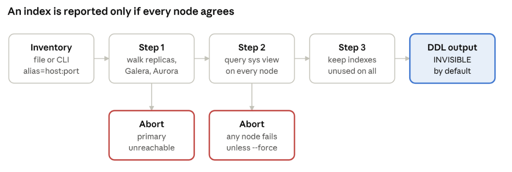

Every MySQL schema that’s been around for a few years collects indexes nobody remembers adding. Some were for a report that was retired. Some came from an ORM migration. A few were added “just in case” and never used. They all cost something: extra writes on every INSERT and UPDATE, increased buffer pool pressure, larger backups, and slower schema changes.

MySQL makes it look easy to find them. Since 5.7, the sys schema ships a view called sys.schema_unused_indexes, and one query gives you a list of indexes with zero reads since the server started. It’s tempting to turn that list straight into DROP INDEX statements.

In an earlier post, [How to Find Duplicate, Unused, and Invisible Indexes in MySQL](https://www.percona.com/blog/duplicate-redundant-and-invisible-indexes/), I showed how to use that view on a single server. This post covers what that approach misses once replicas are involved.

I’ve seen that go wrong, and it’s why I wrote [check_unused_indexes](https://github.com/Percona-Lab/check_unused_indexes). It’s a small Python script that asks the same question on every server in a replication topology and only reports an index when the answer is “unused” everywhere. This post covers why that matters, how the tool works, and how I’d use it on a production system.

## Why one server’s answer isn’t enough

sys.schema_unused_indexes is built on Performance Schema’s per-index I/O counters. Those counters are local to the server you query. They know nothing about what your replicas are doing.

That’s the trap. In most setups, the primary takes writes and the light OLTP reads, while the heavy reads go elsewhere:

- A reporting replica runs month-end queries that lean on an index the application never touches.
- An Aurora reader serves the dashboard traffic, so the writer never sees those lookups.
- In a Galera or Percona XtraDB Cluster, the load balancer may send one kind of query to one node more than the others.

So an index can show zero reads on the primary and still be the only thing keeping a replica’s reporting query under a second. Drop it on the primary, the DDL replicates, and the replica falls over into a full table scan.

There’s a second catch. The counters reset when MySQL restarts. A server patched on Tuesday has seen only a few days of traffic. A weekly batch job or a quarterly report hasn’t run yet, so its indexes look unused when they aren’t.

## How check_unused_indexes works

You give the script a list of servers and tell it which one is the primary. It determines which of those servers belong to that primary’s topology, collects the unused-index lists from each one, and keeps only the indexes that appear on every list. It runs in three steps.



check_unused_indexes · 3 steps, 2 abort points

If the script can’t get a complete answer from every node, it stops instead of printing a list it can’t stand behind.

**Step 1: discover the topology.** The script connects to every server in your inventory and reads a little metadata from each:

- SHOW REPLICA STATUS (or SHOW SLAVE STATUS on older versions) for the source host and port
- @@wsrep_cluster_name, to spot Galera and PXC cluster members
- information_schema.replica_host_status, which only exists on Aurora
- the Uptime status variable

Then it walks downstream from the primary. A replica whose source matches the primary’s address is pulled in, then that replica’s own replicas, and so on. Chained and circular replication are handled the same way. If a node is in a Galera cluster, all its cluster peers are included as well. Aurora readers are matched by server ID, or by an alias naming convention I’ll come back to later.

Servers in the inventory that don’t belong to this primary are left out. That means you can keep a single inventory file for the entire fleet and point the script to different primaries.

**Step 2: ask every node.** For each node in the resolved topology, the script queries sys.schema_unused_indexes. Two filters apply on every node:

- System schemas (sys, mysql, performance_schema, information_schema) are always skipped.
- Any index whose first column is part of a foreign key is excluded. MySQL needs an index on FK columns, and it won’t let you drop one that a constraint depends on. Even if it did, you wouldn’t want to.

You can narrow things further with –include-schema and –include-table, or skip more schemas with –ignore-schema.

**Step 3: intersect.** The script starts with the primary’s list and removes anything that isn’t also on every other node’s list. What’s left is the set of indexes with zero reads everywhere the script looked. It prints that as a table, followed by the DDL to run on the primary.

## Getting started

The script is a single file. It needs Python 3.6 or newer and one library, pymysql.

```
git clone https://github.com/Percona-Lab/check_unused_indexes.git
cd check_unused_indexes
pip3 install --user pymysql
```

Credentials come from a MySQL option file. By default that’s ~/.my.cnf, and you can point at another one with -c:

```
[client]
user=index_audit
password=change_me
```

The account needs to read sys.schema_unused_indexes and information_schema, and to run SHOW REPLICA STATUS. Use the same user on every node. The script reads only and never changes anything on the servers.

There are two ways to tell the script about your servers. For a quick check, you can list them on the command line:

```
python3 check_unused_indexes.py \
  --primary "db-primary=10.0.0.10:3306" \
  --replicas "db-replica-1=10.0.0.11:3306,db-replica-2=10.0.0.12:3306"
```

For anything bigger, I’d use an inventory file. It’s one alias=host:port per line. Blank lines and lines starting with # are ignored, and the port defaults to 3306 if you leave it off.

```
# inventory.txt
db-primary=10.0.0.10:3306
db-replica-1=10.0.0.11:3306
db-replica-2=10.0.0.12:3306
db-analytics=10.0.0.13:3306
```

Then pass the primary’s alias:

```
python3 check_unused_indexes.py --inventory inventory.txt --primary db-primary
```

One thing to check before your first run: the topology walk matches each replica’s Source_Host against the addresses in your inventory, as plain strings. If your replicas were set up with CHANGE REPLICATION SOURCE TO SOURCE_HOST=’db-primary.internal’, put that same hostname in the inventory, not the IP. If the topology comes back with fewer nodes than you expect, this is almost always why.

## A run, step by step

Here’s what a run looks like against the inventory above, with the primary and two replicas reachable. The db-analytics server in the file replicates from a different primary, so the topology walk excludes it. This is the example output from the project README, with the colours stripped.

```
=== Step 1: Discovering Topology ===
Mapping topology downstream from Primary: db-primary...

Resolved Topology (3 nodes): db-primary, db-replica-1, db-replica-2

=== Step 2: Checking Unused Indexes on Nodes ===
Checking [PRIMARY] db-primary (10.0.0.10:3306) - Uptime: 42.1 days
  └─ Found 12 unused index candidates on this node.
Checking [REPLICA/CLUSTER] db-replica-1 (10.0.0.11:3306) - Uptime: 42.1 days
  └─ Found 8 unused index candidates on this node.
Checking [REPLICA/CLUSTER] db-replica-2 (10.0.0.12:3306) - Uptime: 14.0 days
  └─ Found 5 unused index candidates on this node.

=== Step 3: Intersecting Unused Indexes Across Topology ===

Safe Target Indexes (Unused across ALL 3 checked nodes):
================================================================================
SCHEMA               | TABLE                          | INDEX NAME
--------------------------------------------------------------------------------
app_db               | orders                         | idx_legacy_status
app_db               | users                          | idx_created_at
================================================================================

Total Candidate Indexes: 2

Generated DDL Statements (Execute on Primary):
--------------------------------------------------------------------------------
ALTER TABLE `app_db`.`orders` ALTER INDEX `idx_legacy_status` INVISIBLE;
ALTER TABLE `app_db`.`users` ALTER INDEX `idx_created_at` INVISIBLE;
--------------------------------------------------------------------------------
```

Look at the numbers in Step 2. Run the sys query on the primary alone and you get 12 indexes to drop. Only 2 of those 12 are unused on both replicas. The other 10 are carrying read traffic somewhere, and dropping them would have hurt.

That gap between 12 and 2 is the whole point of the tool. Expect a gap like this on most real systems. Replicas exist precisely to take the load the primary doesn’t serve.

If you only want the DDL, for a ticket or a change request, add -qs (–quiet-summary) to skip the table.

## Safety checks: what happens when a node is down

The intersection is only as good as its inputs. If a replica can’t be reached and the script quietly skips it, the result looks complete but isn’t. Any index that replica depends on could end up on the drop list. The latest version therefore refuses to guess.

<table>
<tr><th>Situation</th><th>What the script does</th></tr>
<tr><td>Primary can’t be reached in Step 1</td><td>Stops with a fatal error. Without the primary there’s no topology to walk.</td></tr>
<tr><td>Some inventory nodes can’t be reached in Step 1</td><td>Prints a connection warning naming each one, with a note that they weren’t evaluated.</td></tr>
<tr><td>Primary drops out during Step 2</td><td>Stops at once. There’s nothing to intersect against.</td></tr>
<tr><td>A replica or cluster peer drops out during Step 2</td><td>Stops with a fatal error and lists the nodes, unless you pass–force.</td></tr>
<tr><td>Same, with–force</td><td>Carries on with the nodes that answered, prints a warning, and labels the result “checked nodes”.</td></tr>
<tr><td>A node’s uptime is under the threshold</td><td>Finishes, then warns that its statistics may be incomplete. The default is 7 days; change it with-u, or set 0 to disable it.</td></tr>
</table>

The Step 1 warning needs an explanation. If a replica is already down when you start, the script can’t read its replication status. It has no way of knowing that the node belongs to this topology, so it can’t treat it as missing. All it can do is tell you which inventory entries it couldn’t reach. Read that warning before you trust the result.

–force is there for the case where you know a node is gone for good, such as a replica being decommissioned. Don’t use it to get past a network blip.

The last option is –pause-seconds, which waits between Step 1 and Step 2. It’s meant for testing these checks. Start a run with –pause-seconds 60, stop MySQL on one replica while it waits, and check that the script aborts:

python3 check_unused_indexes.py -i inventory.txt -p db-primary –pause-seconds 60; echo “exit=$?”

You should see FATAL ERROR: Failed to inspect index state on resolved replica/peer node(s) and an exit code of 1. Run it once on a test setup before you rely on it in production.

## From candidate list to dropped index

The script prints DDL and stops there. It never runs anything for you, and that’s on purpose. The list is a set of candidates to review, not a set of orders.

By default, the DDL makes the index invisible rather than dropping it:

ALTER TABLE `app_db`.`users` ALTER INDEX `idx_created_at` INVISIBLE;

Invisible indexes arrived in MySQL 8.0. The optimizer stops using the index, but MySQL continues to maintain it on every write. Making it invisible is a metadata change, and so is undoing it, so rolling back takes seconds. A real DROP INDEX followed by a re-create means rebuilding the index, which on a large table can take hours.

This is the rollout I’d follow:

1. Run the script and read the candidate list yourself. Make sure every name makes sense to you.
2. Run the INVISIBLE statements on the primary. They replicate, so every node in the topology changes.
3. Wait through at least one full business cycle, including the month-end jobs and any weekly batch. Watch the slow query log and your query metrics for regressions.
4. If something slows down, run ALTER INDEX … VISIBLE on that index, and you’re back where you started.
5. Once you’re confident, drop the indexes. –action drop prints the DROP INDEX statements, and –action both prints both kinds.

One more thing before step 5. On MySQL 8.0 you can set use_invisible_indexes=on in optimizer_switch for a single session. That lets you check whether a query you’re unsure about would still pick the index, without making it visible to the application.

For a longer walkthrough of invisible indexes, including testing a single query with SET_VAR(optimizer_switch = ‘use_invisible_indexes=on’), see my [earlier post](https://www.percona.com/blog/duplicate-redundant-and-invisible-indexes/).

## Options at a glance

<table>
<tr><th>Option</th><th>What it does</th><th>Default</th></tr>
<tr><td>-p,–primary</td><td>Primary alias from the inventory, oralias=host:port/host:port</td><td>required</td></tr>
<tr><td>-r,–replicas</td><td>Comma-separated replica specs on the command line</td><td>none</td></tr>
<tr><td>-i,–inventory</td><td>Inventory file, onealias=host:portper line</td><td>none</td></tr>
<tr><td>-c,–config</td><td>MySQL option file with credentials</td><td>~/.my.cnf</td></tr>
<tr><td>-u,–min-uptime</td><td>Warn when a node has been up fewer days than this</td><td>7</td></tr>
<tr><td>–action</td><td>DDL to print:invisible,droporboth</td><td>invisible</td></tr>
<tr><td>-s,–include-schema</td><td>Only check these schemas</td><td>all</td></tr>
<tr><td>-t,–include-table</td><td>Only check these tables</td><td>all</td></tr>
<tr><td>–ignore-schema</td><td>Extra schemas to skip, on top of the system ones</td><td>none</td></tr>
<tr><td>-qs,–quiet-summary</td><td>Print only the DDL</td><td>off</td></tr>
<tr><td>–force</td><td>Continue if a replica fails in Step 2 (unsafe)</td><td>off</td></tr>
<tr><td>–pause-seconds</td><td>Wait between Step 1 and Step 2, for testing</td><td>0</td></tr>
<tr><td>–color</td><td>auto,alwaysornever</td><td>auto</td></tr>
</table>

## Limits worth knowing

No tool can see traffic that hasn’t happened yet, and this one is no exception. Keep these in mind:

- **Only servers in the inventory are checked.** A replica you forgot to list is invisible to the script, and so is everything it serves.
- **Unique indexes can still show up.** sys.schema_unused_indexes excludes primary keys, but not UNIQUE indexes. A unique index can have zero reads and still be enforcing a business rule. Check every candidate with SHOW CREATE TABLE before you drop it.
- **Statistics start at the last restart.** The uptime warning helps, but you decide what “long enough” means for your workload.
- **Performance Schema must be on.** It’s on by default. If someone turned it off, the sys view has nothing to report.
- **Aurora needs an alias convention.** Readers are matched by server ID or by alias prefix. Name the writer aurora and the readers aurora-reader-1, aurora-reader-2 and so on, and they’ll be grouped correctly.
- **Hosts are matched as strings.** As covered above, use the same host name or IP in the inventory as the replicas use in Source_Host.
- **It finds unused indexes, not duplicate ones.** An index can be redundant even if another index covers the same columns. For those, run pt-duplicate-key-checker from Percona Toolkit, as described in the [earlier post](https://www.percona.com/blog/duplicate-redundant-and-invisible-indexes/).

## Try it and tell me what breaks

The project is on GitHub at [Percona-Lab/check_unused_indexes](https://github.com/Percona-Lab/check_unused_indexes) under the Apache 2.0 license. It’s one Python file, so it’s easy to read before you run it against anything that matters, and I’d encourage you to do so.

If it misreads your topology, or you run something it doesn’t handle yet (group replication, multi-source replicas), please open an issue or send a pull request. Real topologies are messier than test labs, and those reports are how the tool gets better.
