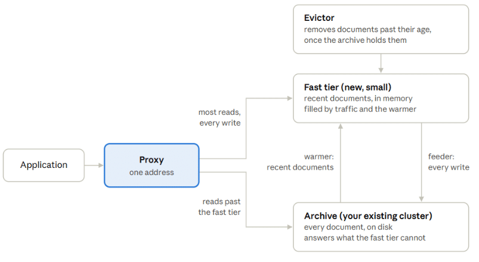
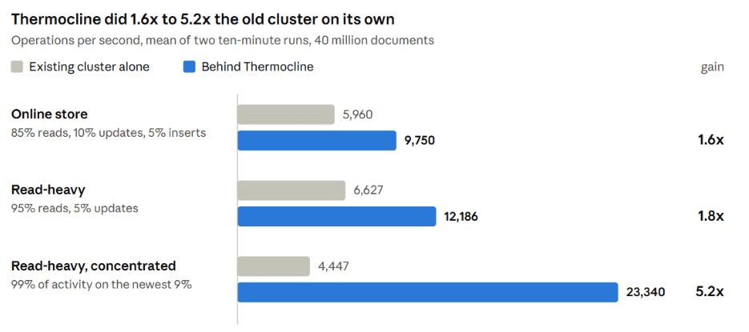
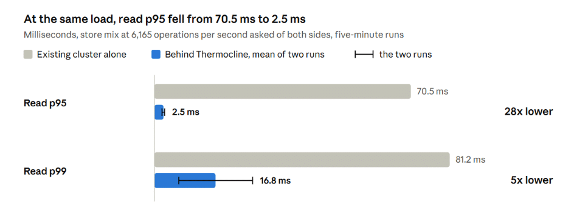
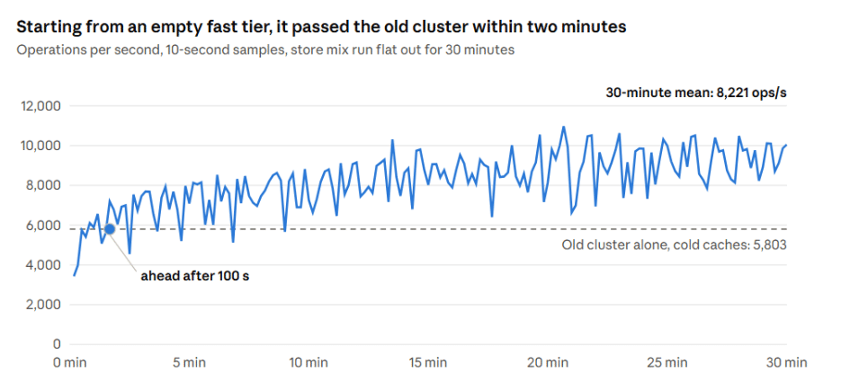

## An alternative to sharding a MongoDB replica set that outgrew its memory: a proof of concept

<iframe src="https://www.youtube.com/embed/EQvyPjn6ehk?feature=oembed" title="Thermocline" width="560" height="315" allowfullscreen></iframe>

### A replica set that no longer fits in memory

Most MongoDB replica sets start small. The working set fits in the WiredTiger cache, reads come from memory, and nobody thinks about disks. Then the data keeps growing. Orders, events and logs pile up for years, and one day the collection is ten times the size of the cache.

From that point every read of a document that is not cached is a read from disk. Latency follows the disk, not the query. On the cluster I tested below, a read *p95* of *70 ms* was not a bad index, it was a disk at its IOPS limit.

The usual answer is **sharding**. It works, but it is a big step and very costly: a shard key you cannot easily change, mongos routers, config servers, balancing, and queries that need the shard key to stay fast. For a team whose real problem is “*most reads are for recent data, and old data is in the way*“, that is a lot of machinery.

The question I wanted to answer: can you keep the replica set you have, and put the recent data somewhere fast in front of it, without changing the application?

### What [Thermocline](https://github.com/zelmario/thermocline) does

**Thermocline is storage tiering for MongoDB.** The cluster you have becomes the archive, exactly as it is. A new, smaller replica set in front of it holds the recent documents. The application connects to a proxy instead of the old cluster.

The application talks to one proxy; age decides which tier holds a document

Four pieces keep the two tiers consistent:

1. **The proxy** speaks the MongoDB wire protocol. It sends a query to the fast tier when the fast tier can prove it holds the whole answer, and to the archive when it cannot. Writes go to the fast tier.
2. **The feeder** reads the fast tier’s change stream and mirrors every write into the archive, so the archive always holds every document.
3. **The evictor** removes documents from the fast tier once they are older than their collection’s age and the archive is confirmed to hold them.
4. **The warmer** fills the fast tier from the archive with what is newer than that age.

Nothing is loaded by hand. The fast tier starts empty and fills from the warmer and from the documents that traffic requests.

### How I measured it

The test cluster ran on Hetzner Cloud. It is built to be the case above, not a flattering one:

- **The existing cluster**: a three-member replica set holding 40 million simulated orders, 47 GB of data. Each member was capped at 2.5 GB of memory (a 1 GB WiredTiger cache) and 3,000 reads per second on its data disk. That is a dataset roughly 47 times the cache.
- **The fast tier**: a second three-member replica set, empty at the start.
- **The load**: YCSB 0.17 with 64 threads, ten-minute runs, two runs per side. Each document carries a date spread over the past year, so “recent” means something.

Three mixes:

- **Online store**: 85% reads, 10% updates, 5% inserts, with reads favouring the newest documents (YCSB’s latest distribution).

1. **Read-heavy**: 95% reads, 5% updates, same distribution.
2. **Read-heavy, concentrate**d: 95% reads, 5% updates, with 99% of the activity on the newest 9% of the documents.

Every run was measured twice: the existing cluster alone, and the same cluster behind Thermocline. Same MongoDB release on both tiers, same caps, same client.

### Results

The same capped cluster did **1.6x** to **5.2x** more operations per second behind Thermocline, with 0 operations refused in any run.

The more the traffic is about recent data, the bigger the gain: the concentrated mix went from 4,447 to 23,340 operations per second. Its read latency fell with it, from a p95 of 86 ms to 6 ms and a p99 of 92 ms to 8 ms.

**At the same load, reads stop waiting for the disk**. I asked both sides for 6,165 operations per second on the store mix, the old cluster’s maximum. Alone, it delivered 6,086 with a read p95 of 70.5 ms. Behind Thermocline it delivered 6,156 and 6,159 in two runs, with a read p95 of 2.8 ms and 2.1 ms. The p99 moved between 7 and 27 ms from one run to the next, against 81 ms alone. The archive’s disk did 1,838 reads per second instead of 2,704.

**Adoption starts from an empty fast tier.** The realistic first day is a fast tier with nothing in it, filled by traffic and the warmer. Over 30 minutes of the store mix, flat out, the pair averaged 8,221 operations per second, 42% more than the old cluster alone with cold caches (5,803). It passed the old cluster’s number after 100 seconds, averaged 6,417 in the first five minutes and 9,146 in the last five, and copied 271,271 documents up from the archive on the way.

### Where it does not help

The gain comes from reads that the fast tier can answer. Everything else still lands on the existing cluster, and that sets the limits:

- **Writes still reach the archive.** Every write is mirrored to the existing cluster, and mirroring an update means the archive reads that document from disk first. In the store mix, updates ran at the old cluster’s speed, and the update p99 was higher than alone (455 to 472 ms against 104 to 189 ms). I am working on that tail now.
- **Reads of old data are as slow as before.** A query that reaches past what the fast tier holds goes to the archive. If your reads are spread evenly over all of history, there is little to gain.
- **Both tiers must run the same MongoDB release.** The archive answers the application’s own queries, so it has to understand them. Adopting an older cluster means upgrading it first.
- **It is a proof of concept.** It has an extensive test suite, but it has not run in production. Do not point real traffic at it yet.

The gain depends on the mix: **1.6x** on the store mix and **5.2x** when activity is concentrated on recent data, on the same hardware. Measure your own case before believing mine.

### Why it matters

A replica set that outgrew its memory usually gets one of two answers: bigger machines, or sharding. Both cost money and time, and sharding changes how the application has to be written. Tiering is a third option for the common case where most of the traffic is about recent data: keep the cluster you have as the archive, put a small fast cluster in front of it, and let age decide where each document lives.

The code is on GitHub at[github.com/zelmario/thermocline](https://github.com/zelmario/thermocline), under the **Apache 2.0 license**, and its README explains how to run it.

If you have a replica set in this situation, I would like to hear about it, and even more about a workload where this does not work. Issues and pull requests are welcome.

**Note: This is a proof of concept.**
**Thermocline** is a POC I built to answer one question: can a small fast cluster in front of an existing replica set take the load off it, without changing the application, so that sharding or bigger servers are not the only way out?

The results say it can be a viable alternative for the right workload. The numbers come from a test cluster. It has not run in production yet.
