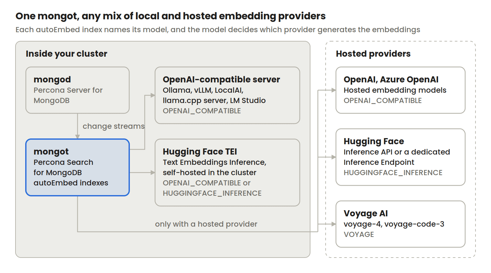
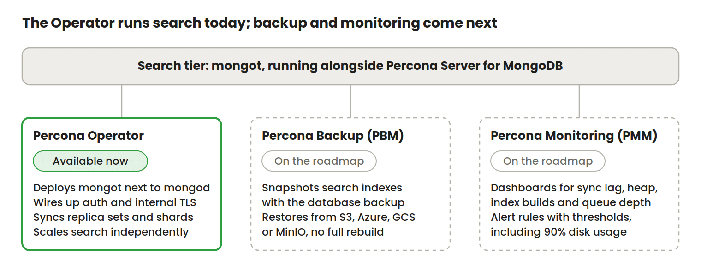

Percona Search for MongoDB 1.70.5-3 is now Generally Available and supported for production use. You can now easily run full-text, vector, and hybrid searches with automatic embedding on production Percona Server for MongoDB deployments. The release also adds the Hugging Face Inference API as a new automatic embedding provider.

In this blog post, I cover why search now belongs next to the database, what held self-managed vector search back, what changed since the [Technical Preview in August](https://www.percona.com/blog/the-open-way-of-percona-search-for-mongodb/), and which parts of operations Percona tooling covers today and which come next.

## Why semantic search matters to your database

Nowadays, people resign themselves to searching by exact keyword or document ID. They prefer to type what they mean, such as “orders that arrived damaged last month”, and expect results that match the intent even when the stored text uses different words. AI applications and agentic workflows even raise the stakes. For example, a Retrieval-Augmented Generation (RAG) pipeline or an agent needs to retrieve context from your database before the model writes a response, but the model only sees the top handful of results. With MongoDB, this is much simpler. Running the retrieval inside MongoDB means there is no separate search database cluster to feed. Percona Search for MongoDB runs as a `mongot` search engine process alongside `mongod` and keeps your data and search indexes in sync through change streams.

## What holds back self-managed vector search

While deployment is easy with MongoDB, we’ve found some challenges in adopting Vector Search in MongoDB production environments. That’s why we’ve decided to fork MongoDB’s `mongot` search engine into Percona Search for MongoDB and solve the following adoption walls:

### Sovereignty

In MongoDB Vector Search Community and Enterprise Edition releases, automatic embedding is available only with Voyage AI models. Every document you index and every query your users type are sent to Voyage AI’s cloud to be converted into vectors. For support tickets, contracts, or patient notes held in a database you host yourself, that is often a dealbreaker. Moreover, air-gapped environments cannot use automatic embedding at all, and teams with data-residency obligations usually cannot either.

### The bill

Hosted embedding is metered per token. You pay on every insert, update, search query, reranking, and chunking, so the cost grows with your data and your traffic, and changing models means paying to re-embed the whole corpus.

### Operations

A lost search index can be rebuilt from `mongod`, but the index builds can take days. The faster path is a manual filesystem snapshot: stop `mongot`, copy its data directory, and restore it later. That snapshot has no scheduling, no point-in-time consistency with your database backup, and it becomes useless once it is older than your oplog window. The monitoring aspect is equally critical to vector search as it is to the database itself. For example, at 90% disk usage, `mongot` stops applying change events to existing indexes, so search serves stale results while the database reports healthy. Additionally, when there are no search indexes, the query returns no results, unlike traditional database indexing behavior. Without a monitoring and alerting system, your users will again be blind to silent failures.

## Automatic embedding with your choice of model

At first, we’re solving the sovereignty wall and ease of use of automatic embeddings. `mongot` can generate embeddings for existing documents, update them as documents change, and embed the query text at search time. Your application sends plain text, and no one on your team needs to maintain a separate embedding pipeline that keeps vectors in step with the data.

Percona Search for MongoDB lets you pick where that inference runs. You can configure models from several providers on the same `mongot` instance, and the model named in each `autoEmbed` index decides which provider handles it.

We built this local-first. With a local OpenAI-compatible server or an in-cluster Hugging Face TEI model, document text stays inside your cluster and search works without outbound network access, so air-gapped deployments can use automatic embedding. There are no per-token charges on that path; the cost is the hardware you run the model on. You can also use the model that performs best in your language, or one your data science team fine-tuned.

Hosted providers stay available for teams that prefer them. Through OpenAI, Azure OpenAI and the Hugging Face Inference API you can reach more than 2,000 models, and Voyage AI remains supported. We plan to add more providers, and we intend to bring reranking with open cross-encoder models such as `BAAI/bge-reranker-large` after that.

## What’s new in 1.70.5-3

Version 1.70.5-3 moves Percona Search for MongoDB from Technical Preview (1.70.3-1, August 2026) to General Availability. It is based on upstream `mongot` 1.70.5, so it includes the latest upstream fixes; the full list is in the [MongoDB release notes](https://www.mongodb.com/docs/search/self-managed/current/release-notes/#release-notes).

### Hugging Face Inference API as an embedding provider

The new `HUGGINGFACE_INFERENCE` provider joins `VOYAGE` and `OPENAI_COMPATIBLE`. It offers a hosted option for open embedding models without requiring you to run your own embedding server, providing you access to thousands of different models.

`mongot` calls the Hugging Face `hf-inference` feature-extraction pipeline, which serves open sentence embedding models such as `BAAI/bge-small-en-v1.5`. It authenticates with your Hugging Face access token, sent as a bearer token. Setup steps are in [Configure automatic embedding with the Hugging Face Inference API](https://docs.percona.com/percona-search-for-mongodb/configure-automatic-embedding-huggingface.html).

## Running search with Percona tooling

Our goal is to enable you to operate the search tier using the same tools you already use for the database. Today, we already support Kubernetes deployment with our Operator. The next item on the roadmap is Backup and Monitoring.

## License and support

Percona Search for MongoDB is free to use, with no paid edition, deployment limits or license-gated features. Like upstream `mongot`, it is published under the Server Side Public License (SSPL), which is source-available. You can read the code at [github.com/percona/percona-mongot.](https://github.com/percona/percona-mongot) If you need Percona Services (which is optional), contact us and we’ll happily cover your new search tier, along with Percona Server for MongoDB, the Operator, PBM, and PMM.

## Get started and tell us what you need

To install, follow [Install Percona Search for MongoDB](https://docs.percona.com/percona-search-for-mongodb/install-mongot.html). You may also want to play with our [sample demo application.](https://github.com/sandraromanchenko/pl-demo)

We want to know which problems Percona Search for MongoDB solved for you, which embedding provider or model you need that we do not support yet, and where operating it was harder than it should be. Post on the [Percona Search for MongoDB forum](https://forums.percona.com/c/mongodb/percona-search-for-mongodb/89) or talk to your Percona representative.
