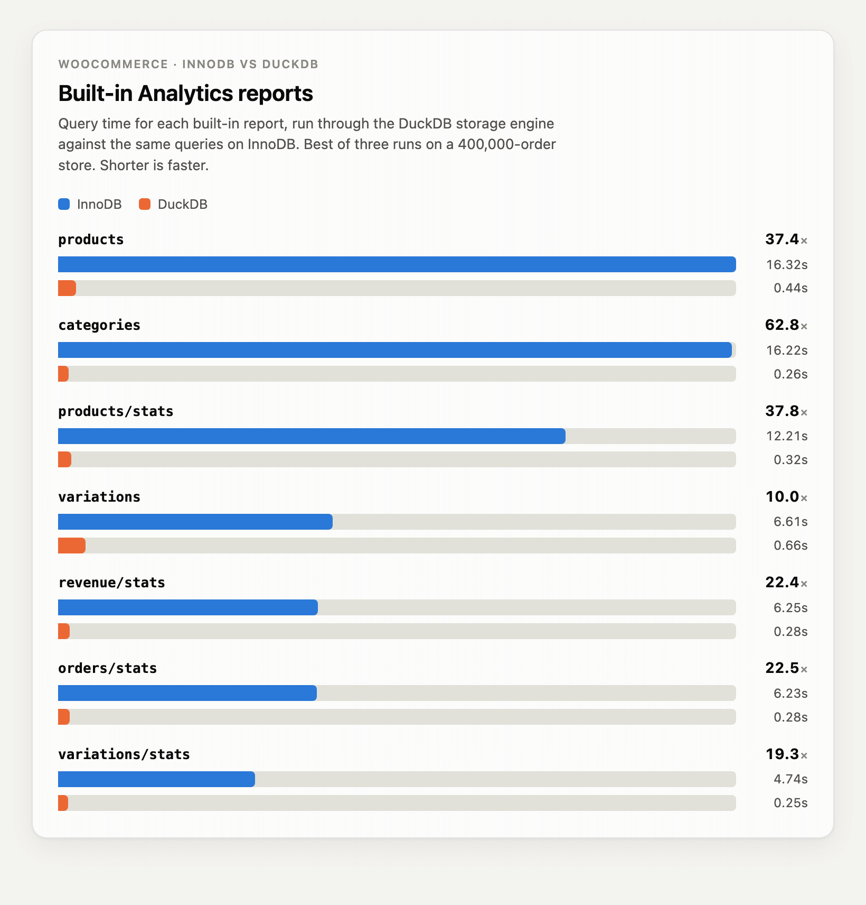
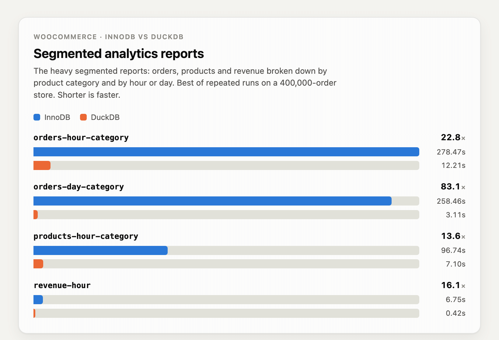
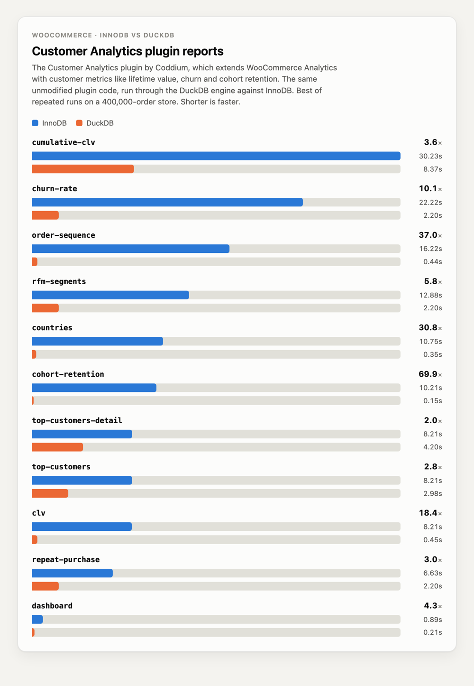
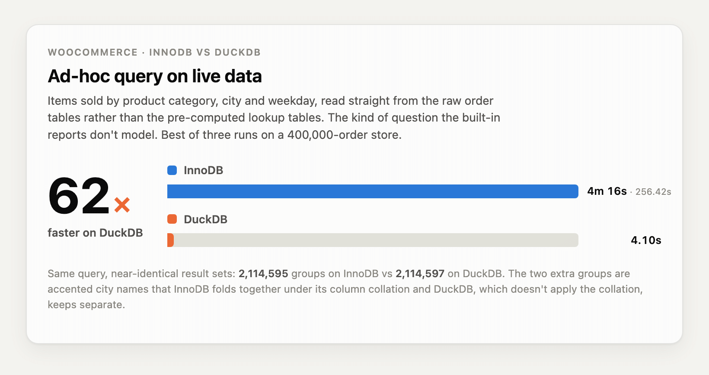

### MySQL and DuckDB

Unlike row-oriented databases, which store data for a single record sequentially on disk, favoring single-row lookups, columnar databases store all the values from a column contiguously in storage, allowing only the selected column to be read from disk.

The default MySQL engine is InnoDB, which is ACID-compliant and great for OLTP (Online Transaction Processing) workloads. That said, OLAP (Online Analytical Processing) queries are built differently; they scan, group, and summarize millions or billions of rows to produce reports. In these cases, the InnoDB engine can be slow to process such queries. This has been a debt in MySQL over the years; it was common to setup ETL/CDC pipelines to export or stream the data to another engine, usually a columnar database system, to run reporting and BI queries on it.

DuckDB is a portable analytical database system, designed to be fast and reliable, similar to SQLite.

Recently, various vendors (MariaDB, Alibaba) started including DuckDB inside MySQL as a storage engine. A table declared with ENGINE=DuckDB stores data in columnar format, and queries are handled by the DuckDB engine.

This is useful in several ways; the main one is to use MySQL asynchronous replication to stream data from the OLTP, using the InnoDB engine, to a Replica where tables are in DuckDB, thereby offloading the OLAP workload to the replica. To showcase this, we thought that the best example was an on-line store which naturally requires both: short, fast, scalable transactions for the store frontend, and analytics for the store’s reporting and Business Intelligence, and what better than the free and open-source software that serves between 20 and 40% of the world’s e-commerce websites: WooCommerce.

### WooCommerce

There are around 4M WooCommerce stores worldwide, the most of any e-commerce platform, handling between 20 and 39% of all e-commerce sites, and they use MySQL as their underlying database.

One of the reasons stores have been adopting computers for over 50 years, is the value of having accumulated information about your business’ transactions. This data collection allows business owners to understand trends and find new opportunities, by turning raw data into metrics that marketing and sales departments can act upon. This process is based on the long-term accumulation of large amounts of data and metadata, and that accumulation is often incompatible with transactional/row-oriented storage engines.

WooCommerce has a built-in analytics module to create those reports that provide metrics, so it is the perfect product to test the performance difference between InnoDB and DuckDB.

WooCommerce analytics does not run its reports against live order tables because querying these tables would be too slow. Instead, it keeps a set of aggregations in a number of denormalized “lookup” tables, which are optimized for this purpose. This is a limitation when running reports with InnoDB, as querying the raw tables would kill performance, and thus the reports are limited to what you can get from these lookup tables.

The following lookup tables are created for WooCommerce Analytics:

```
mysql> SHOW TABLES LIKE '%wc_%lookup'; SHOW TABLES LIKE '%wc_order_stats';
+-------------------------------------+
| Tables_in_woocommerce (%wc_%lookup) |
+-------------------------------------+
| wp_wc_category_lookup               |
| wp_wc_customer_lookup               |
| wp_wc_order_coupon_lookup           |
| wp_wc_order_product_lookup          |
| wp_wc_order_tax_lookup              |
| wp_wc_product_attributes_lookup     |
| wp_wc_product_meta_lookup           |
+-------------------------------------+
7 rows in set (0.00 sec)

+-----------------------------------------+
| Tables_in_woocommerce (%wc_order_stats) |
+-----------------------------------------+
| wp_wc_order_stats                       |
+-----------------------------------------+
1 row in set (0.00 sec)
```

The wp_wc_order_stats table is the spine of the revenue and orders reports; it contains one row per order, including dates, status, customer, number of items sold, and the monetary totals.

In the store we’re using, the wc_order_stats table contains 400000 rows, and there are 5000 products. This data was loaded using the [WooCommerce Smooth Generator plugin](https://github.com/woocommerce/wc-smooth-generator).

The lookup tables are derived data, so WooCommerce has to keep them in sync with the orders they summarize, which it does in the background (which means you have to run a scheduled process that is what keeps these lookup tables updated).

### MySQL Deployment

We deployed a Source/Replica MySQL topology with both databases on the same host, each with its respective Docker image.

#### Source

The Source runs Percona Server for MySQL 8.0.46, which we chose to match the replica’s major version.

WooCommerce tables use the MySQL default engine, which is InnoDB.

We configured an InnoDB Buffer Pool of 4 GiB:

```
[mysqld]
innodb_buffer_pool_size=4G
```

#### Replica

For this test, as a Replica we deployed AliSQL 8.0.44-2, Alibaba’s MySQL branch based on MySQL 8.0.44, which includes the [DuckDB](https://github.com/alibaba/AliSQL/blob/master/wiki/duckdb/duckdb.md) storage engine along with other features such as Vector Search and Flashback. At this moment, this is the latest available version.

We configured the DuckDB instance with the following settings:

```
[mysqld]
duckdb_memory_limit=4G    # maximum memory DuckDB is allowed to use
force_innodb_to_duckdb=ON # force-replace the InnoDB engine with DuckDB
duckdb_threads=0          # total number of threads used by DuckDB. 0 equals system CPU cores.
```

You can find full reference for DuckDB settings here [https://github.com/alibaba/AliSQL/blob/master/wiki/duckdb/duckdb_variables-en.md](https://github.com/alibaba/AliSQL/blob/master/wiki/duckdb/duckdb_variables-en.md)

The force_innodb_to_duckdb option is mandatory in this process, as it is the way to tell MySQL to use DuckDB engine for tables created via replication or mysqldump.

After loading the 5000 products and 400K orders, the size of the WooCommerce database directory using the InnoDB engine was 7.3 GiB:

```
$ du -sch woocommerce/
7.3G woocommerce/
```

While on the replica where tables have been created with DuckDB, the dataset fits in just 601 MiB:

```
$ du -sch duckdb.db
601M duckdb.db
```

That is a solid 12x improvement on disk footprint!

### Sending reports queries directly to the Replica

We wanted to find a way to make the process as transparent as possible, but WooCommerce uses WordPress’s single database connection object for everything, which means that the reports’ code will use the global $wpdb, and there is no setting that would allow us to send this reporting/analytics traffic to a different server, or an easy way to introduce a second connection object to the code. This means you are stuck with a single server, so there would be no easy way to make use of both InnoDB and DuckDB copies.

Thus, we had to come up with some solution to run the reports against the replica. We like simple stuff, so instead of changing the existing WooCommerce installation at all, we run a whole second copy of the same WooCommerce installation that connects to the replica, and we push the analytics traffic to that second WooCommerce copy.

The original install of your store stays exactly as it is, with its `wp-config.php` which already points to the primary (InnoDB/transactional) database:

```
define( 'DB_HOST', 'ps8.example.local' );   // Percona Server for MySQL 8.0.46, InnoDB
```

And the second install is just a full copy of the first, in its own directory, with just one line of code changed: the database host.

```
$ cp -aL /var/www/html /var/www/html2;  # we assume your WooCommerce install is /var/www/html 
$ chown -R apache:apache /var/www/html2 # and we also assume you run Apache; should not be hard to adapt for Nginx or other web servers
```

In the copy’s wp-config.php we change only the host and leave the table prefix, the authentication keys, everything else untouched:

```
define( 'DB_HOST', 'duckdb8.example.local'' );  // AliSQL 8.0.44 with the DuckDB storage engine, the replica
```

The second install gets a dedicated pool, listening on its own socket, and its own virtual host on an internal port, handing `.php` to that pool:

```
# /etc/httpd/conf.d/html2.conf
<VirtualHost 127.0.0.1:8080>
    DocumentRoot /var/www/html2
    <Directory "/var/www/html2">
        AllowOverride All
        Require all granted
    </Directory>
    <FilesMatch \.php$>
        SetHandler "proxy:unix:/run/php-fpm/www2.sock|fcgi://localhost"
    </FilesMatch>
</VirtualHost>
```

With that in place, we have two addresses for (essentially) the same WooCommerce, each using a different database:

– `http://127.0.0.1:80/` is the store, on Percona Server for MySQL 8.0.46 (InnoDB).

– `http://127.0.0.1:8080/` is the copy, on DuckDB replica.

Every analytics call we benchmark goes to one or the other, so the same report is run against InnoDB and against DuckDB from the same codebase, changing nothing but the database underneath.

### Benchmark Methodology

Each report was run several times, and we kept the fastest run for each.

Before comparing times, we verified that both engines returned the same result set: the same number of rows and the same values, once serialized and sorted. A few reports differed because the DuckDB engine computes decimals as double-precision floating-point rather than exact DECIMAL, so some monetary sums ended up a fraction of a cent apart. While this might be of concern when dealing with real money, for reporting the precision DuckDB provides should be more than enough, as the difference between the reports was always below 1 cent.

The two engines never ran at the same time. Every report ran first on InnoDB and then on DuckDB, so they never competed for CPU, memory, or disk (at the web server layer).

A few reports whose SQL relied on MySQL-only syntax failed outright on DuckDB and were discarded rather than rewritten, since the point was to run the same query on both engines.

We drove the benchmarks through WooCommerce’s own Analytics REST API, sending the same report requests to each engine and timing the responses.

Each report was run with the force_cache_refresh parameter, so the result is computed from the database on every call rather than served from WooCommerce’s cache.

### Built-in Analytics Reports

We started with the built-in [WooCommerce Analytics](https://woocommerce.com/products/woocommerce-analytics/) reports. All reports used the same window, from 2024-01-01 to 2026-09-01, over a store of 400,000 orders. The stats reports were aggregated by month; the detail reports returned up to 100 rows per page.



Every built-in report ran faster on DuckDB, from about 10x to nearly 63x, and all of them finished in under a second against InnoDB’s 5 to 16. The biggest improvement resulted from the category reports, where the heavy grouping and aggregation show the columnar engine’s strength.

### Built-in Analytics Segmented Reports

The built-in reports are not limited to a single total over a date range. Each stats report takes an interval, so you can ask for the same figures broken down by hour, day, week, or month, and several of them also accept a segmentby parameter, which splits the totals along a dimension. Segmenting by category, for example, returns revenue or order numbers per product category rather than as a single combined figure, which is how the Analytics screens generate their breakdowns.

The finer the interval and the more segments involved, the more the report asks of the database. These are the reports we use to compare InnoDB and DuckDB because they are where the underlying engine makes the most difference.



Every segmented report ran faster on DuckDB, ranging from about 14x to 83x faster. Segmenting by category and time pushes InnoDB into multi-minute queries, while DuckDB still answers in seconds, so the heavier the breakdown, the wider the gap.

### WooCommerce Customer Analytics Plugin

To see whether the engine helps with real third-party code, not just the built-in reports, we also benchmarked the [Customer Analytics for WooCommerce](https://coddium.com/customer-analytics-for-woocommerce/) plugin from Coddium.

It extends WooCommerce Analytics with customer metrics the built-in reports do not provide: customer lifetime value, churn rate, RFM segments, cohort retention, repeat purchase rate, order sequence, and acquisition sources, among others.

Like the built-in reports, each of these reads from the same WooCommerce Analytics lookup tables, making it a good test of whether a plugin written for MySQL runs faster on the DuckDB engine without any changes of its own.



Even with a third-party plugin we did not modify, all eleven reports ran faster on DuckDB, from about 2x to nearly 70x faster.

### Ad-hoc Query on Live Data

As mentioned, the built-in analytics reports are served from precomputed lookup tables, which only answer the questions they were designed to answer. For anything else, you have to query the live order tables directly. So we tested an expensive query against those tables to compare the performance.

In this case, we wanted to know how many items were sold, broken down by product category, city, and day of the week, across the store’s orders in the date range. We came up with the following query:

```
SELECT
  tt.term_taxonomy_id                            AS category_id,
  LOWER(a.city)                                  AS city,
  DAYOFWEEK(o.date_created_gmt)                  AS dow,
  SUM(CAST(im_qty.meta_value AS DECIMAL(10,2)))  AS items_sold
FROM woocommerce.wp_wc_orders o
JOIN woocommerce.wp_wc_order_addresses a
  ON a.order_id = o.id AND a.address_type = 'billing'
JOIN woocommerce.wp_woocommerce_order_items oi
  ON oi.order_id = o.id AND oi.order_item_type = 'line_item'
JOIN woocommerce.wp_woocommerce_order_itemmeta im_prod
  ON im_prod.order_item_id = oi.order_item_id AND im_prod.meta_key = '_product_id'
JOIN woocommerce.wp_woocommerce_order_itemmeta im_qty
  ON im_qty.order_item_id = oi.order_item_id AND im_qty.meta_key = '_qty'
JOIN woocommerce.wp_term_relationships tr
  ON tr.object_id = CAST(im_prod.meta_value AS DECIMAL(20,0))
JOIN woocommerce.wp_term_taxonomy tt
  ON tt.term_taxonomy_id = tr.term_taxonomy_id AND tt.taxonomy = 'product_cat'
WHERE o.type = 'shop_order'
  AND o.status IN ('wc-completed','wc-processing')
  AND o.date_created_gmt >= '2024-01-01' AND o.date_created_gmt < '2026-09-01'
GROUP BY category_id, LOWER(a.city), dow;
```

The execution time difference between both engines can be found below:



Across three runs each, DuckDB was consistently about 4.1 seconds and InnoDB about 4 minutes 16 seconds.

The results are not identical, and the two extra groups come from how each engine compares text. Since the city column uses a case- and accent-insensitive collation that InnoDB applies, it folds an accented spelling and its plain form into a single group. The DuckDB engine does not apply the collation and compares text byte-for-byte, keeping them apart.

No orders are missing on either side; the same rows are simply bucketed into two more groups.

### Limitations

We ran into the following limitations when performing the above benchmarks:

- DuckDB SQL compatibility

Since the DuckDB storage engine executes queries in its own engine, the SQL syntax should be portable. A query that runs fine on InnoDB can fail on DuckDB when it uses a keyword or data type that DuckDB does not recognize. For example, the CAST function in MySQL accepts the UNSIGNED keyword, but when it’s pushed into DuckDB, it fails with the following error:

```
ERROR 7501 (HY000): [DuckDB] Catalog Error: Type with name UNSIGNED does not exist!
Did you mean "JSON"?.
```

Such queries need to be rewritten so DuckDB can process them. This can be automated with query-rewrite tools such as [ProxySQL Query Rewrite](https://proxysql.com/documentation/query-rewrite/) feature or [MySQL’s Rewriter Query Rewrite plugin](https://dev.mysql.com/doc/refman/8.4/en/rewriter-query-rewrite-plugin.html), which we will cover in a separate blog post.

- Collation

Unlike InnoDB, DuckDB does not apply the column collation and forces binary comparison. This can produce different result sets between engines.

For example, the following SELECT COUNT result set differs between DuckDB and InnoDB:

```
# DuckDB
mysql> SELECT COUNT(DISTINCT city) FROM woocommerce.wp_wc_order_addresses WHERE address_type='billing' AND city<>'';
+----------------------+
| COUNT(DISTINCT city) |
+----------------------+
|               114412 |
+----------------------+
1 row in set (0.02 sec)

# InnoDB
mysql> SELECT COUNT(DISTINCT city) FROM woocommerce.wp_wc_order_addresses WHERE address_type='billing' AND city<>'';
+----------------------+
| COUNT(DISTINCT city) |
+----------------------+
|               114375 |
+----------------------+
1 row in set (1.38 sec)
```

This is caused by DuckDB bypassing the column collation.

If we force binary comparison when running the query on InnoDB, we obtain the same result set as DuckDB:

```
# InnoDB BINARY
mysql> SELECT COUNT(DISTINCT BINARY city) FROM woocommerce.wp_wc_order_addresses WHERE address_type='billing' AND city<>'';
+-----------------------------+
| COUNT(DISTINCT BINARY city) |
+-----------------------------+
|                      114412 |
+-----------------------------+
1 row in set, 1 warning (1.34 sec)
```

To prevent this, group and join should be done on numeric IDs rather than text.

- Decimals computed as Double

To improve performance, DuckDB does not support DECIMAL precision by default, so monetary columns are summed in floating point instead. This can lead to differences at sub-cent digits. If you need exact decimal values, you can disable the duckdb_use_double_for_decimal variable when importing the data.

We have not yet fully tested performance implications of disabling this, but we plan to cover this in another blogpost, in the near future.

- Foreign keys

Traditionally in MySQL, cascaded foreign key operations such as ON DELETE CASCADE were handled internally by InnoDB, below the SQL layer, so they were not written to the binlog files.

Because the DuckDB storage engine does not perform these cascades itself, changes to child rows would be lost when replicating from InnoDB to DuckDB.

Starting with MySQL 9.6, foreign key cascades are handled at the SQL layer by default, so the affected rows are recorded in the binary log, making replication across different engines transparent.

The following MySQL blog post explains this change in detail:

[https://blogs.oracle.com/mysql/no-more-hidden-changes-how-mysql-9-6-transforms-foreign-key-management](https://blogs.oracle.com/mysql/no-more-hidden-changes-how-mysql-9-6-transforms-foreign-key-management)

WooCommerce does not use cascading foreign keys, so this limitation does not apply in this case.

- Observability

DuckDB exposes only a few of status variables. Status variables mostly show counters for statements (`Com_duckdb_select`, `Com_duckdb_insert`) and rows processed in batches.

InnoDB, by comparison, exposes dozens of status variables covering the buffer pool, I/O, row operations, and locking, and is instrumented in detail through the Performance Schema.

So there is little visibility into what the DuckDB engine is doing internally, such as memory use, disk spilling, or query execution, which makes monitoring and tuning harder than on InnoDB.

This gap makes sense though, given how much longer InnoDB has existed; DuckDB has had far less time to build equivalent instrumentation.

### Why Columnar engine wins?

The reason is physical, and it comes down to how the data is stored on disk. InnoDB is a row store; it keeps all of a row’s columns together, which is ideal for transactional work, where you read or write an entire row at a time.

Analytics asks the opposite question. A report rarely needs the whole row; it sums one column, counts another, and groups by a third, across millions of rows.

In a row store, answering that means reading every full row from the B-tree and discarding most of it.

A columnar engine stores each column separately, so it reads only the fields a query touches, compresses them far better because the values share a type, and processes them in batches instead of row by row. Reading less, reading it in compressed form, and processing it in bulk is what turns InnoDB’s minutes into DuckDB’s seconds. The heavier the aggregation, the wider the gap, which is exactly what the benchmarks showed.

P.S. DuckDB is a potential solution for analytics use cases, and this post is part of our testing. At this time, Percona does not have a production DuckDB build and does not support it.
