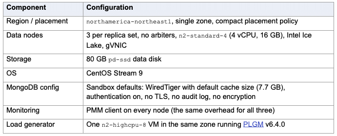
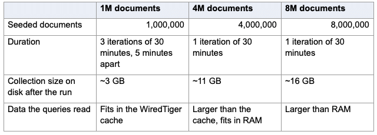
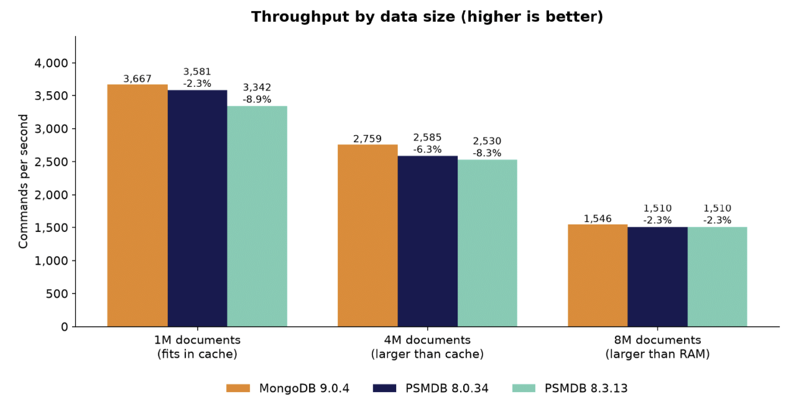
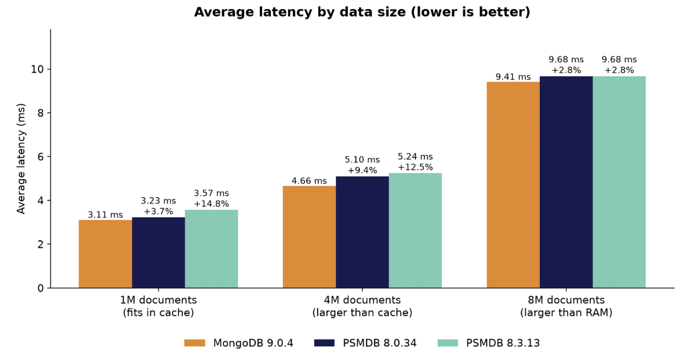
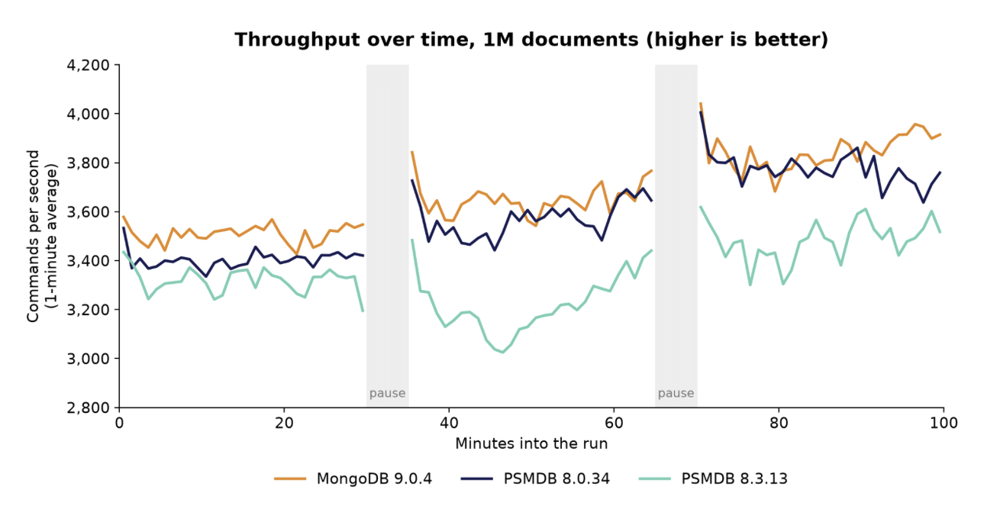
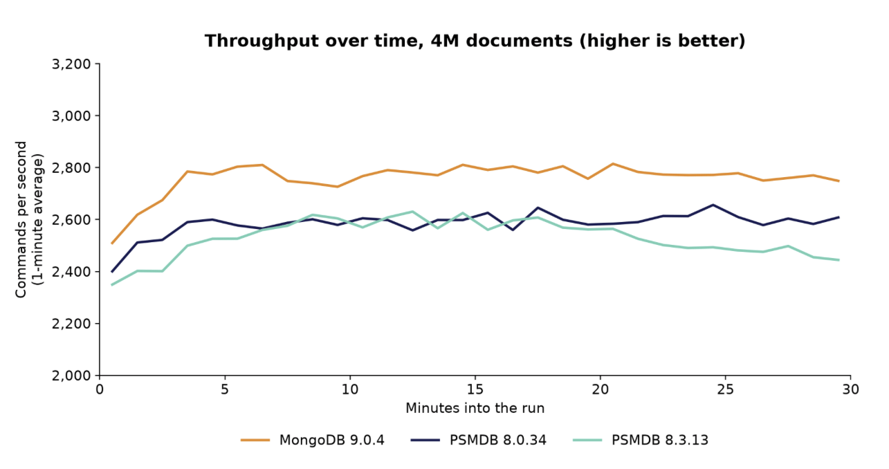
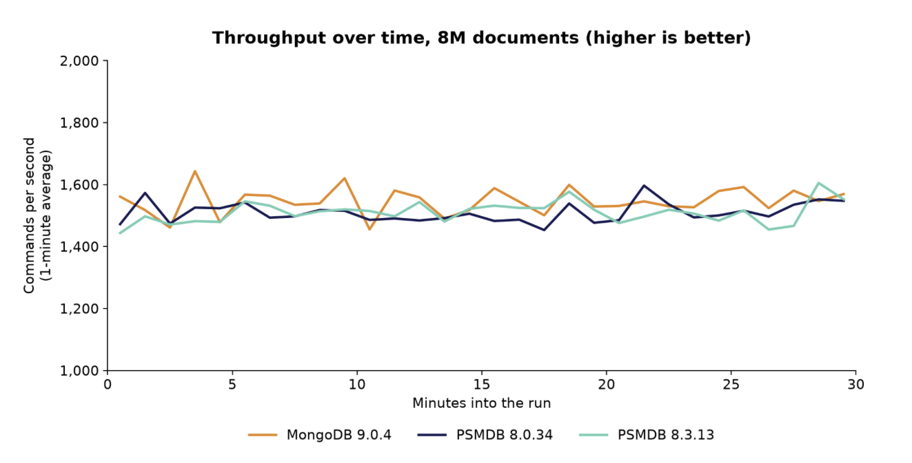
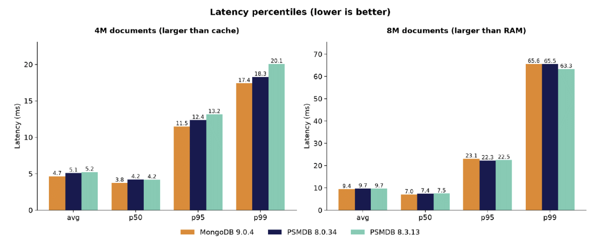
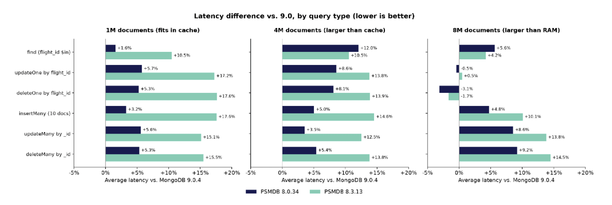

In my [previous post](https://www.percona.com/blog/mongodb-9-0-more-8-4-than-9-0/) I said that MongoDB published some impressive numbers for 9.0, but I couldn’t find any details about how the tests were done. I ended with “always run your own benchmarks”. So I figured I should follow my own advice.
Let me be clear up front: this is a first, quick test, not an extensive benchmark by any means. It’s one workload, one hardware configuration for three different data sizes. Treat the numbers as an early indication, not a verdict. I’m sharing them anyway, together with everything you need to do your own tests.

## Test setup

### Infrastructure

I deployed everything with [PSMDB Sandbox](https://github.com/percona/psmdb-sandbox) on Google Cloud. Each version ran on its own three-node replica set, and the three replica sets were identical except for the MongoDB package version:



Versions tested:

- **mongo9**: MongoDB Community 9.0.4
- **psmdb80**: Percona Server for MongoDB 8.0.34-15
- **psmdb83**: Percona Server for MongoDB 8.3.13-4

*Note: PSMDB is built from the same upstream code, and none of the PSMDB-specific features were enabled in order to keep the configuration as similar as possible.*

### Workload

I used PLGM’s built-in “flights” workload (collection airline.flights, 7 secondary indexes):

- 60% finds (flight_id $in lookups)
- 20% updates (updateOne by flight_id, updateMany by _id)
- 10% deletes (deleteOne by flight_id, deleteMany by _id)
- 10% inserts (batches of 10 documents)
- Writes use the server’s default write concern, so they include replication.
- 16 workers, with no think time: each worker sends its next command as soon as the previous one returns
- Collections are dropped and seeded again before each iteration.

I ran the workload three times, with three data sizes:



Queries read the seeded documents, while inserts keep adding new ones, so the collection grows during the run. “Fits in RAM” here means the compressed data still fits in the operating system’s file cache, so a WiredTiger cache miss usually doesn’t need a disk read. With 8M documents, the compressed collection is about as big as the server’s entire memory. The compression ratio is about 2:1, so 25% of the documents can fit in WTcache.
All runs were **deterministic**. Each command is generated from a fixed seed, iteration, worker and operation number, so every MongoDB version received exactly the same commands with the same values, and in the same order for each worker. Each worker had a pass of 250,000 commands per iteration. In the 1M and 4M runs every version finished at least one full pass, and PLGM’s traffic fingerprints matched. In the 8M run the servers were too slow to finish a pass in 30 minutes, so each version sent the first 2.7–2.8M commands of the same sequence. PLGM flags that as incomplete. Because the commands are still identical, I compared them operation by operation anyway.
PLGM ran the three versions one after another, so each one had the load generator to itself.

## Results

### At a glance



*Figure 1: Throughput with 1M, 4M and 8M documents. Percentages are relative to MongoDB 9.0.4.*



*Figure 2: Average latency with 1M, 4M and 8M documents.*



*Figure 3: Throughput over time with 1M documents, in 1-minute averages. Each line is plotted on its own run clock.*



*Figure 4: Throughput over time with 4M documents, in 1-minute averages. 9.0 stayed ahead for the whole run.*



*Figure 5: Throughput over time with 8M documents, in 1-minute averages. The three lines overlap most of the time.*

### Latency percentiles



*Figure 6: Average, median, p95 and p99 latency with 4M and 8M documents. With 4M documents 9.0 is ahead on every percentile; with 8M documents the tails are about the same.*



*Figure 7: How much higher (or lower) the average latency of 8.0 and 8.3 was than 9.0, by query type, for each data size.*
The pattern changes with the data size. With 1M documents, 9.0’s advantage over 8.0 was mostly in writes. With 4M documents, finds show the biggest difference (+12%). With 8M documents, the single-document updates and deletes by flight_id, which have to fetch a document that is probably not in memory, were the same on all three versions or even slightly faster on 8.0. 9.0 stayed ahead on finds, inserts and the _id-based operations.

### Query plans

After each run, PLGM ran explain on samples of each type of query. All three versions chose exactly the same plans with every data size:

- finds: LIMIT → FETCH → IXSCAN on flight_id_1_equipment.plane_type_1
- updates and deletes by flight_id: UPDATE/DELETE → FETCH → IXSCAN on the same index
- updateMany and deleteMany by _id: EXPRESS_UPDATE and EXPRESS_DELETE on _id_

So the differences are not caused by different plans.

## How to repeat the test

You can run the same or a different test yourself, and I’d encourage you to do so.

### 1. Deploy the environment

With PSMDB Sandbox (web UI or tfvars), create a GCP environment with three replica sets, a PLGM host and PMM:

```
region                 = "northamerica-northeast1"
zone_mode              = "single"
compact_placement      = true
replsetsvr_type        = "n2-standard-4"
replsetsvr_volume_size = 80
data_disk_type         = "pd-ssd"
min_cpu_platform       = "Intel Ice Lake"
nic_type               = "GVNIC"
enable_pmm             = true
enable_plgm            = true
plgm_type              = "n2-highcpu-8"

clusters = {}
replsets = {
  mongo9 = {
    data_nodes_per_replset = 3
    mongodb_distribution   = "community"
    mongo_release          = "9.0"
    mongo_version          = "9.0.4"
    enable_pbm             = false
    enable_mongot          = false
  }
  psmdb80 = {
    data_nodes_per_replset = 3
    mongodb_distribution   = "psmdb"
    mongo_release          = "psmdb-80"
    mongo_version          = "8.0.34"
  }
  psmdb83 = {
    data_nodes_per_replset = 3
    mongodb_distribution   = "psmdb"
    mongo_release          = "psmdb-83"
    mongo_version          = "8.3.13"
  }
}
```

PLGM comes pre-installed on the PLGM host. Open an SSH tunnel with ssh -F _ssh_config -plgm, then go to http://127.0.0.1:29999. The connection string for each replica set is displayed on the environment page.

### 2. Run PLGM

In the web UI, choose **Run a generic workload** and set **Run on** to **Several servers**. Then enter the settings below. If you prefer the command line, here are the settings for the 1M run as environment variables:

```
export PLGM_DEFAULT_WORKLOAD=true
export PLGM_DOCUMENTS_COUNT=1000000
export PLGM_DROP_COLLECTIONS=true
export PLGM_CONCURRENCY=16
export PLGM_DURATION=30m
export PLGM_ITERATIONS=3
export PLGM_INTERVAL_DELAY=5m
export PLGM_FIND_PERCENT=60
export PLGM_UPDATE_PERCENT=20
export PLGM_DELETE_PERCENT=10
export PLGM_INSERT_PERCENT=5
export PLGM_BULK_INSERT_PERCENT=5
export PLGM_AGGREGATE_PERCENT=0
export PLGM_TRANSACTION_PERCENT=0
export PLGM_INSERT_BATCH_SIZE=10
export PLGM_FIND_BATCH_SIZE=10
export PLGM_FIND_LIMIT=5
export PLGM_READ_PREFERENCE=secondary
export PLGM_RANDOM_SEED=178477
export PLGM_WORKLOAD_DETERMINISTIC=true
export PLGM_OPERATIONS_PER_WORKER=250000
export PLGM_WORKLOAD_RECORD_OUTCOMES=true
export PLGM_WORKLOAD_DETERMINISTIC_OUTCOMES_PATH=/var/lib/plgm/outcomes.ndjson
export PLGM_WORKLOAD_REPLAY_TARGETS_MODE=sequential
export PLGM_WORKLOAD_REPLAY_TARGETS="mongo9=mongodb://:@/?replicaSet=mongo9;psmdb80=mongodb://...;psmdb83=mongodb://..."
plgm
```

For the 4M run, change PLGM_DOCUMENTS_COUNT=4000000 and PLGM_ITERATIONS=1. For the 8M run, use PLGM_DOCUMENTS_COUNT=8000000 and PLGM_ITERATIONS=1.
With the same seed and settings you should get the same traffic fingerprints I got: c0a88fae… for the 1M run and 9734a782… for the 4M run.
More useful than this benchmark is to use your own workload. PLGM can run with your own custom collection definitions and queries, or replay traffic captured from your mongod logs.

## To sum up

In this quick test, MongoDB 9.0 used less CPU per operation than 8.0 and 8.3 with every data size. That made it about 6% faster when the CPU was the bottleneck, but only about 2% faster when the data fit comfortably in memory or when the disk was the limit. The query plans were the same everywhere. 8.3 was the slowest of the three whenever the CPU mattered.
That’s a nice improvement, but on its own it isn’t a reason to upgrade in a hurry. Before you expect anything from 9.0, find out what limits your own servers. Next, I want to repeat the test a few more times, try different levels of concurrency and faster disks, and look at why 8.3 needs more CPU. I’ll share the results in a follow-up post.
Like I said in [my previous post](https://www.percona.com/blog/mongodb-9-0-more-8-4-than-9-0/), treat 9.0 as a release to test, not one you have to deploy urgently. And if you run some tests yourself, I’d like to hear what you get.
