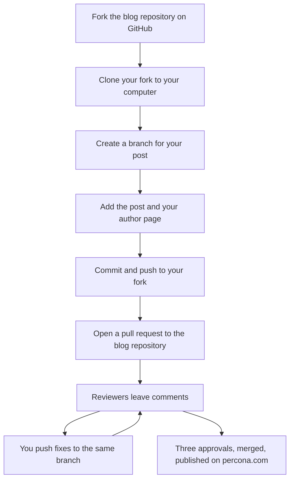

This is an example post for community authors, and it is also the guide. If you have written a post for percona.com/blog but have never opened a pull request, start here. It assumes no Git experience.

If you are a Perconian, you do not need any of the fork steps. You work right in the repository. Read the [example post for Perconians](https://github.com/dbazhenov/percona-test-blog-repo/tree/main/posts/2026/how-a-perconian-publishes) instead.

## How it works

The blog lives in a GitHub repository. You cannot change it directly, and that is normal for open source: nobody outside the team can. Instead, you make your own copy of the repository, add your post there, and ask us to take it in. Your copy is called a **fork**, and the request is a **pull request**.

1. Fork the blog repository on GitHub. This makes your own copy under your account.
2. Set up an SSH key, so your computer can send changes to GitHub.
3. Clone your fork, which downloads it to your computer.
4. Create a branch for your post.
5. Add your post and your author page.
6. Commit the files and push them to your fork.
7. Open a pull request from your fork to the blog repository.
8. Reviewers read the post. You push fixes to the same branch.
9. After three approvals the post is merged and published on percona.com.

The same steps as a diagram:



It looks like a lot, but most of it is a one-time setup. Your second post starts at step 4.

## What you need

- A [GitHub account](https://github.com/signup). It is free.
- Git on your computer. On a Mac, run `xcode-select --install` in the Terminal, or `brew install git` if you use Homebrew. On Windows, install [Git for Windows](https://git-scm.com/download/win); it comes with Git Bash, a terminal where every command in this post works.
- An SSH key. The next sections show how to make one.
- Your post, in any form: a Google Doc, a Word file, or Markdown.

## Let an AI agent help

You do not have to type all of this yourself. AI coding agents such as Cursor and Claude Code are good at exactly this kind of setup: they can install Git, create an SSH key, clone your fork, and turn your draft into a post file. The repository has notes for agents, so they know where files go and which rules to follow.

The easiest start is to give the agent a link to this post or to the [blog repository](https://github.com/dbazhenov/percona-test-blog-repo), and your draft:

- "Here is how to publish a community post on the Percona blog: https://github.com/dbazhenov/percona-test-blog-repo. Help me publish my draft from ~/Downloads/post.docx."

The agent reads the instructions and walks you through the rest. You can also ask for one step at a time, in plain words:

- "Help me create an SSH key and add it to my GitHub account."
- "Clone my fork of percona-test-blog-repo and create a branch for a new post."
- "Turn my draft in ~/Downloads/post.docx into a post for this blog and open a pull request."

Read what the agent is about to run before you say yes. And never paste your private SSH key into a chat, a form, or an email. Only the public key, the file that ends in `.pub`, ever goes to GitHub.

## Step 1. Fork the repository

Open the [blog repository](https://github.com/dbazhenov/percona-test-blog-repo) and press **Fork** in the top right corner. Keep the suggested name and press **Create fork**.

You now have `github.com/<your-username>/percona-test-blog-repo`. It is yours: you can push to it, break it, and fix it, and nothing happens to the blog.

## Step 2. Set up an SSH key

An SSH key is how GitHub knows that a push really comes from you. It is a pair of files. The private key stays on your computer, and the public key goes to GitHub.

Create the key. Use the email of your GitHub account:

```bash
ssh-keygen -t ed25519 -C "you@example.com"
```

Press Enter to accept the default file. You can set a passphrase or leave it empty.

Print the public key and copy the whole line:

```bash
cat ~/.ssh/id_ed25519.pub
```

On GitHub, open **Settings**, then **SSH and GPG keys**, then **New SSH key**. Paste the line, give it a name like "My laptop", and save.

Check that it works:

```bash
ssh -T git@github.com
```

The first time, it asks whether to trust github.com. Type `yes`. You should see `Hi <your-username>! You've successfully authenticated`.

> If you would rather not deal with SSH, [GitHub Desktop](https://desktop.github.com/) signs you in through the browser and does the same steps with buttons. The rest of this post uses the terminal, because that is what an AI agent will use too.

## Step 3. Clone your fork

Cloning downloads your fork to your computer. Replace `<your-username>` with yours:

```bash
git clone git@github.com:<your-username>/percona-test-blog-repo.git
cd percona-test-blog-repo
```

Then tell Git where the original blog repository is. You will need that later to keep your fork up to date:

```bash
git remote add upstream https://github.com/dbazhenov/percona-test-blog-repo.git
```

## Step 4. Create a branch

A branch keeps your post separate from everything else. Name it `blog/` plus a short name for your post, in lowercase words with hyphens:

```bash
git switch -c blog/replication-lag-pt-heartbeat
```

## Step 5. Add your post and your author page

Your post goes into its own folder, `posts/<year>/<post-name>/index.md`, with its pictures next to it. If this is your first post, you also add an author page, `authors/<name-surname>/index.md`, with your portrait next to it.

Community posts set `origin: community` in the front matter, and your author page sets `type: community`. This post is a first post too, so its pull request adds both: the post in `posts/2026/community-post-from-a-fork/` and the author page in [`authors/mateo-alvarez/`](https://github.com/dbazhenov/percona-test-blog-repo/tree/main/authors/mateo-alvarez), with a square portrait next to it.

The [example post for Perconians](https://github.com/dbazhenov/percona-test-blog-repo/tree/main/posts/2026/how-a-perconian-publishes) explains every field, how to choose categories and tags, and which formatting you can use. Everything there applies to you too, except the part about working without a fork. This post is also a working example: look at its folder in the repository.

If you have an AI agent open, this is the step to hand over: give it your draft and ask it to prepare the post.

## Step 6. Commit and push

A commit saves your changes in Git. A push sends them to your fork on GitHub:

```bash
git add posts authors
git commit -m "Add a post on measuring replication lag"
git push -u origin blog/replication-lag-pt-heartbeat
```

`origin` is your fork. You can never push to the blog repository itself, so you cannot break anything by accident.

## Step 7. Open the pull request

Open your fork on GitHub. A yellow bar says your branch had recent pushes. Press **Compare & pull request**.

Check the top of the page: the base should be `dbazhenov/percona-test-blog-repo` and `main`, and the head should be your fork and your branch. Give the pull request the title of your post, and fill in the short template: who the post is for, and anything that is missing, such as a cover.

Leave **Allow edits by maintainers** checked. Then the blog team can fix a typo in your branch without asking you to do it.

Press **Create pull request**.

## Step 8. Review and fixes

Within a few minutes, the first comment on your pull request links to a preview of your post. It shows how the post will look on the blog.

For your first pull request, a maintainer has to approve the automatic checks before they run. That is a GitHub rule for new contributors, and it only happens once.

Reviewers leave comments in the pull request. To fix something, change the file on your computer, then commit and push again to the same branch:

```bash
git add posts
git commit -m "Fix the code example"
git push
```

The pull request and the preview update on their own. You do not need to open a new pull request.

After three approvals, the post is merged and published on percona.com. You do not need to do anything for that.

## Your next post

Before you start the next post, bring your fork up to date with the blog:

```bash
git switch main
git pull upstream main
git push origin main
```

Then start again from step 4, with a new branch.

## If you get stuck

- **`Permission denied (publickey)`** when you push or clone: GitHub does not know your SSH key. Go back to step 2 and run `ssh -T git@github.com`.
- **`Permission denied` or `403`** when you push: you are probably pushing to the blog repository instead of your fork. Run `git remote -v`. `origin` should point to your username.
- **The checks are red:** open the failed check and read the last lines. It names the file and the problem, such as a category that is not on the list or a missing picture.
- **Anything else:** ask in the pull request. Reviewers have all been new to this once.
