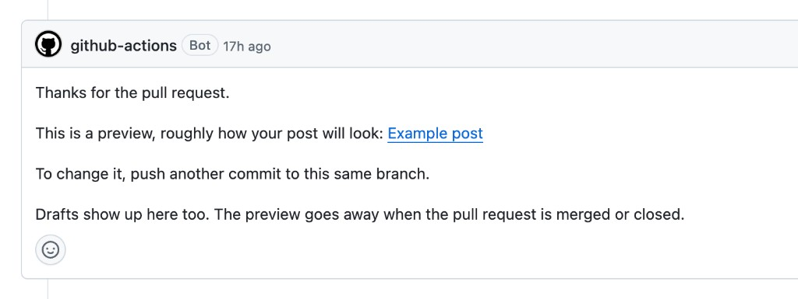

This is a demo post. It will never be published, and its pull request stays open on purpose. Open the pull request and look around: this is what yours will look like before it is merged.

## What to look at in this pull request

**The first comment.** A minute or two after a pull request is opened, a bot comments with a link to a preview of the post. The preview is a copy of the blog with your post in it. It stays up for as long as the pull request is open, so the link in this pull request always works.

**The checks.** At the bottom of the Conversation tab, the Feed check builds the blog and checks the files: the author page exists, the category is on the list, every picture is where the text says. Here it is green. If yours is red, open it and read the last lines; they name the file and the problem.

**The files.** The Files changed tab shows everything a first post adds:

- `posts/2026/demo-open-pull-request/index.md`: the post itself.
- `posts/2026/demo-open-pull-request/cover.png` and `preview-comment.png`: the cover and a picture from the text, next to the post.
- `authors/daniil-bazhenov-example/index.md` and `avatar.png`: the author page and portrait. You add these only with your first post.

**The review.** A real post is merged after three approvals from people who know the subject. This one is never approved or merged.

## The published examples

These went through the same kind of pull request and are on the blog now. Each one is also a guide.

| Example | What is in it |
| --- | --- |
| [How a Perconian publishes a post](https://apps.percona.community/new-wordpress-blog/how-a-perconian-publishes/) | The whole process for employees: the post file, front matter fields, categories and tags, the preview, review, changing a published post, and every formatting element with labeled headings. |
| [Your first community post, from a fork to a pull request](https://apps.percona.community/new-wordpress-blog/community-post-from-a-fork/) | The same for community authors who are new to Git: forking, an SSH key, cloning, branches, pushing, and how an AI agent can do most of it for you. |
| [Example post](https://apps.percona.community/new-wordpress-blog/example-post/) | A short tour of the Markdown a post can use: headings, lists, a table, code, a diagram, and images. |

Their source files are in [`posts/2026/`](https://github.com/dbazhenov/percona-test-blog-repo/tree/main/posts/2026) in the repository. Copying the folder of the closest one is the easiest way to start your own post.
