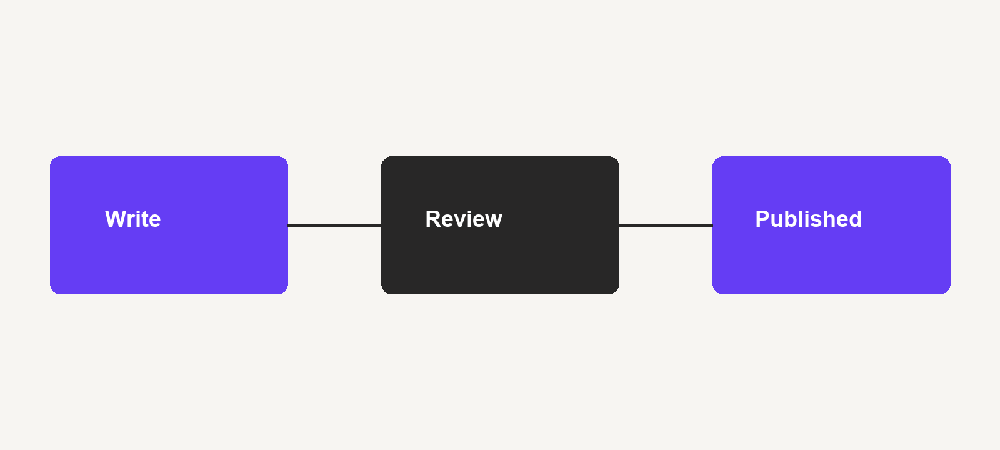
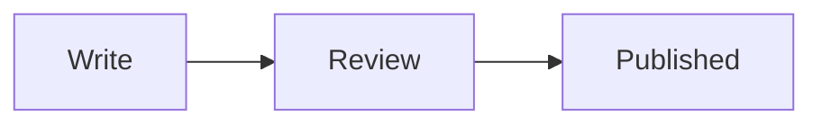

This post is an example, not a product announcement. It shows the Markdown an author can use in a pull request. The first paragraph is the excerpt when `description` is left empty. Here `description` is set, so the excerpt comes from that field instead.

## Text

A paragraph can use **bold**, *italic*, and ***both***. A crossed-out phrase uses ~~strikethrough~~. File names and commands sit in `inline code`, for example `make -C tools check`.

A link can point at a page on the site, such as the [Percona Blog](https://www.percona.com/blog/), or at a project, such as [pgvector](https://github.com/pgvector/pgvector).

> A block quote is for a short remark you want to set apart from the paragraph above it.

## Lists

Unordered:

- Write the post in Markdown.
- Put images next to `index.md`.
- Open a pull request.

Ordered:

1. Open the preview.
2. Read the post.
3. Approve it or ask for a change.

Nested:

- Review checks three things:
  1. The author page exists.
  2. The category is one of the known names.
  3. Every image file sits next to the post.

Tasks:

- [x] Cover, 1200×630
- [x] Diagram
- [ ] A second review

## A figure

The cover is the first name in `images`. It is the picture at the top of the post. Other pictures are ordinary Markdown images and stay in the article.



## Table

| Piece | Where it goes |
| --- | --- |
| Post | `posts/<year>/slug/index.md` |
| Images | Next to `index.md` |
| Author | `authors/<id>/index.md` |

## Code

A fenced block keeps the language name. This one is SQL:

```sql
SELECT extname
FROM pg_extension
WHERE extname = 'vector';
```

## Diagram

A diagram is a Mermaid block. The preview draws it, so a screenshot is not required.



## A shorter heading

### Detail

#### A note under the detail

That is the set used for a normal post: headings, emphasis, lists, a quote, a figure, a table, a code block, and a diagram.
