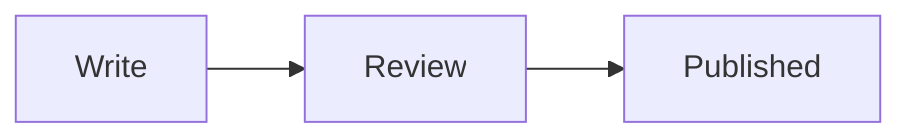

A Perconian post is a pull request. You bring the writing, three people who know the subject approve it, and the merge publishes it.

## The file has two parts

The file is Markdown. The first part is front matter: the block between the two `---` lines at the top. That is the data about the post, such as the title, the author, and the category. The second part is the article, everything after the closing `---`.

Leave a blank line between them. The preview and the published post both read the two parts separately.

## Front matter

`title` is the name of the post. It becomes the H1 on the page. Do not add another H1 in the article. A lot of people start the text with `# Title` because that is what other editors do. Here that makes a second title. Start the article at `##`.

`id` is the permanent name. Set it once, to the filename without `.md`, and leave it alone. The public address is `/blog/` plus that id, unless you set `slug`. You can rename the file later. Changing `id` makes a new post.

`slug` is optional. Set it only when the public address should differ from `id`.

`date` is for the preview. When the post is published, the build replaces it with the time that build finishes. A later edit does not move that date. If you write a date and no time, that means midnight in `America/Los_Angeles`.

`draft` is `false` when the post should be published. `true` keeps it off the feed and off the main site. The pull request preview still shows it. To take a published post down, set `draft: true` and keep the file. Deleting the file leaves the published post up.

`origin` is `percona` for a Perconian and `community` for anyone else. A `percona` post can list only `staff` authors.

`description` is the summary on the blog. Leave it empty and the summary is the first paragraph of the article.

`authors` is a list of ids, the folder names under `authors/`. Not display names. This post lists `daniil-bazhenov`.

`categories` has to be a name from `tools/data/wp-categories.txt`: MySQL, MariaDB, PostgreSQL, MongoDB, or Valkey. The import does not create categories. If you need a new one, open an issue instead of inventing a spelling.

`tags` are ordinary words. They go out with the post.

`images` lists files that sit next to the post. The first name is the cover, 1200×630.

```yaml
title: "Example post: how a Perconian publishes a post"
id: how-a-perconian-publishes
date: 2026-11-12T12:00:00-08:00
draft: false
origin: percona
description: "One or two sentences for the summary."
authors:
  - daniil-bazhenov
categories:
  - PostgreSQL
tags:
  - example
images:
  - cover.png
```

The author has a page of their own, `authors/<id>/index.md`. Its front matter is `id`, `name`, `type` (`staff` or `community`), `role`, `company`, `github`, `linkedin`, and `image`. The text under that block is the bio. A Perconian uses `type: staff`. The id is `name-surname`, lowercase, with hyphens. `name_surname` and `Name-Surname` are rejected.

## Where to put the files

Branch from `main`. Copy `tools/archetypes/blog.md`.

With pictures, use a folder, `posts/<year>/slug/index.md`, and put the image files next to it. In the text, link the filename, as this post does with `steps.png`. With no pictures, one file is enough: `posts/<year>/slug.md`. Do not put a date in the filename.

## Formatting examples

These are the pieces a post can use. The headings here start at H2, because the title is already the H1.

## A section

A section is `##`.

### A subsection

A subsection is `###`.

#### A note

A note under that is `####`.

A sentence can use **bold**, *italic*, and ***both***. ~~This part was revised.~~ A command sits in `inline code`, for example `make -C tools check`.

A link can point at the [Percona Blog](https://www.percona.com/blog/).

> Three approvals. Not one, and not two.

A short list:

- Write the post in Markdown.
- Put images next to `index.md`.
- Open a pull request.

A sequence:

1. Branch from `main`.
2. Add the post, and an author page if you do not have one.
3. Open the pull request.

One list inside another:

- Before review, look at three things:
  1. The author page exists.
  2. The category is a known name.
  3. Every image file is next to the post.

A checklist:

- [x] Cover, 1200×630
- [x] Author page
- [ ] Three approvals

A picture in the article, separate from the cover:


A table:

| Piece | Where it goes |
| --- | --- |
| Post | `posts/<year>/slug/index.md` |
| Images | Next to `index.md` |
| Author | `authors/<id>/index.md` |

Code keeps its language name:

```sql
SELECT extname
FROM pg_extension
WHERE extname = 'vector';
```

A diagram is a Mermaid block. The preview draws it, so you do not need a screenshot of the picture.



The article column is 855px wide, so a picture around 1600px wide is enough. Aim for about 200–400 KB a file. A file of 3–4 MB is too heavy. The cover is 1200×630. A portrait is square, about 400px, and it is shown at 96px.

## Before you ask for review

Read it on your own machine first.

```bash
make -C tools serve
```

Open http://localhost:1314/ . Drafts are included there. `make -C tools preview` builds the same HTML without drafts.

Then:

```bash
make -C tools check
```

The check catches a missing author page, a bad author id, a category that is not in the list, and an image named in the post whose file is not next to it. It does not judge the writing.

Ask people who know the subject to read the pull request. It is merged after 3 approvals. One or two are not enough. The same rule applies when the pull request edits a post that is already published. If nobody reviews it, or someone declines it, close it and try a different post.

## What runs on the pull request

Two workflows start when the pull request is opened or updated. They are not the same job.

**Preview comment** leaves one comment with a link to this post on the preview. Push another commit to the same branch and the preview is built again. That link is how the post will look. It is not the published post. Render removes the preview when the pull request is merged or closed.

**Feed** checks the files while the pull request is open. It publishes when the pull request is merged. You can also publish by hand: Actions, Feed, Run workflow. A normal push to `main` does not publish.

Publishing writes the publication date, builds `wordpress.json`, and replaces the `feed` branch. Do not commit on `feed`, and do not open a pull request against it. The next publish replaces that branch. WordPress is then asked to download the file. The address is the variable `WORDPRESS_SYNC_URL`. The token is the secret `WORDPRESS_SYNC_SECRET`, the same value as Sync secret in the plugin. A token saved as a variable is not sent.

## After it is published

For about three days, a change is another pull request. Say which post, and what should change. The publication date stays at the first publish.

After about three days the text on the site may already have been edited outside git. A commit will not replace it. Open an issue, name the post, and describe the change.
