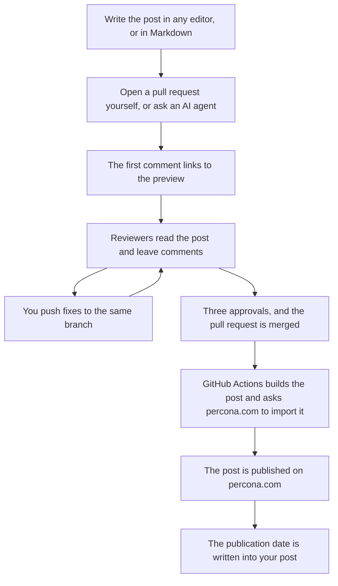
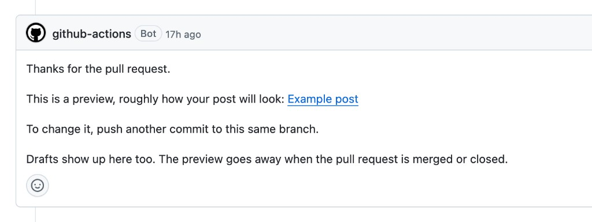
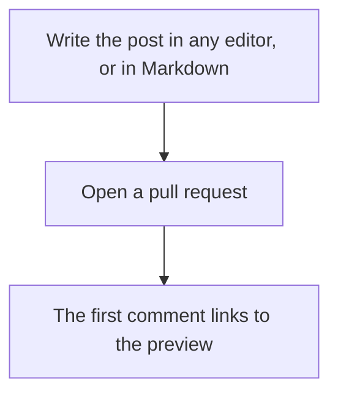
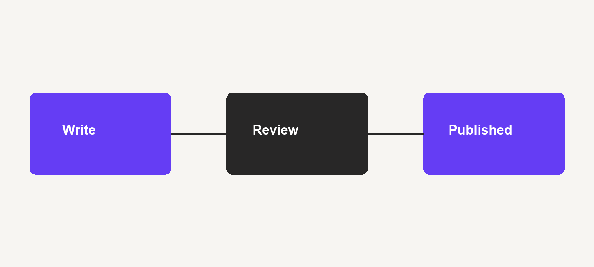

This is an example post, and it is also the instructions. It shows how a Perconian gets a post onto percona.com/blog, and it uses the formatting it describes.

## How it works

A post goes from your draft to percona.com in a few steps:

1. Write the post wherever you like: Google Docs, Word, or straight in Markdown.
2. Open a pull request in this repository yourself, or ask an AI agent to turn your draft into one.
3. Open the preview. The first comment on the pull request links to it, so you can see how the post will look on the blog.
4. Wait for review. Reviewers read the post and leave comments. You answer them and push fixes to the same branch, and the preview updates.
5. After three approvals, the pull request is merged.
6. GitHub Actions builds the post and asks percona.com to import it. The post is published.
7. The publication date is written into your post file, so the repository and the site agree.

The same process as a diagram:



You can draw diagrams like this in your own posts. They are written in [Mermaid syntax](https://mermaid.js.org/intro/syntax-reference.html): flowcharts, sequence diagrams, timelines, and more. The source of this one is in "Formatting examples" at the end of this post.

The rest of this post goes through each step.

## What a post file looks like

A post file has two parts. At the top, between two `---` lines, is the front matter: a few fields about the post, such as the title, the author, and the category. Below it is the text of the post.

A small post looks like this:

````markdown
---
title: "Why the replica fell behind"
id: why-the-replica-fell-behind
authors:
  - daniil-bazhenov
categories:
  - MySQL
tags:
  - replication
---

Last week a replica on one of our test clusters fell an hour behind.

## What we checked first

The first thing we looked at was the IO thread.
````

The title from the front matter is shown at the top of the page as the post heading. The text starts right after the closing `---`.

## Where to put the files

Create a branch from `main`. The easiest start is a recent post in [`posts/`](https://github.com/dbazhenov/percona-test-blog-repo/tree/main/posts): copy its folder, rename it, and replace the text, the pictures, and the fields with your own. Give it a new `id` and `slug`, or it will clash with the post you copied. Real posts show how everything fits together better than any template.

A post with pictures is a folder: `posts/<year>/<name>/index.md`, with the image files next to `index.md`. In the text you link a picture by its filename, as this post does with `steps.png`. A post with no pictures can be one file, `posts/<year>/<name>.md`. Do not put a date in the name.

If this is your first post, add an author page too: `authors/<your-id>/index.md`, with a square portrait next to it. Your id is `name-surname`, lowercase, with hyphens. A Perconian sets `type: staff`. Look at the other folders in `authors/` for the fields.

## Front matter fields

| Field | Required | What to put there |
| --- | --- | --- |
| `title` | Yes | The post title. It is the heading at the top of the page. |
| `id` | Yes | A permanent name, the same as the file or folder name. Set it once and do not change it. |
| `slug` | No | Only if the address should differ from `id`. The address is `/blog/<slug>/`. |
| `date` | Yes | Any date for the preview. Publishing replaces it with the real publication time. |
| `draft` | Yes | `false` to publish. `true` keeps the post off the site and off the feed. |
| `origin` | Yes | `percona` for a Perconian, `community` for anyone else. |
| `description` | No | One or two sentences for the post card. Empty means the first paragraph is used. |
| `authors` | Yes | Author ids from `authors/`, not display names. |
| `categories` | Yes | One to three names from the category list in the next section. |
| `tags` | No | A few words that help readers find related posts. See the next section. |
| `images` | Yes | Files next to the post. The first one is the cover, 1200×630. |

The front matter of this post:

```yaml
title: "Example post: how a Perconian publishes a post"
id: how-a-perconian-publishes
date: "2026-11-12T12:00:00-08:00"
draft: false
origin: percona
description: "How a post gets from your draft to percona.com/blog."
authors:
  - daniil-bazhenov
categories:
  - PostgreSQL
tags:
  - example
images:
  - cover.png
slug: how-a-perconian-publishes
```

A few things that are easy to get wrong:

- Changing `id` after publication makes a second post. Renaming the file is fine as long as `id` stays the same.
- The date you type is only for the preview. The real date is set when the post is published, and later edits do not move it.
- To take a published post down, set `draft: true` and keep the file. Deleting the file leaves the post on the site.

## Categories and tags

Categories are the sections of the blog: readers open percona.com/blog/category/mysql/ and see every MySQL post. A tag is narrower. It says what the post is about inside that section: a tool, a feature, a kind of problem.

### Choosing a category

These are the categories that exist on percona.com/blog. Copy the name exactly as it is written here.

| Group | Categories |
| --- | --- |
| Databases | MySQL, MariaDB, PostgreSQL, MongoDB, Valkey |
| Percona products | Percona Server for MySQL, XtraDB Cluster (PXC), Xtrabackup, Percona Monitoring and Management, ProxySQL, Percona Software, Percona Services |
| Topics | Kubernetes, Operator, Cloud, Security, Monitoring, Benchmarks, AI & Vector, Storage Engine, Open Source, Insight for DBAs, Insight for Developers, Database Trends |

- Start with the database. Almost every post has one, and it is the section most readers browse.
- Add a product if the post is about a Percona product, for example `Percona Server for MySQL` or `Percona Monitoring and Management`.
- Add a topic only if the whole post is about it: a benchmark goes to `Benchmarks`, a post on running the database in Kubernetes goes to `Kubernetes`.
- One to three categories is enough. A post filed everywhere is hard to find anywhere.
- If the post compares two databases, list both.
- If nothing fits, do not invent a name. The import does not create categories, so the post would land without one. Ask in the pull request, and the category can be added to the site first.

The front matter of a post about upgrading PostgreSQL with the Percona Operator:

```yaml
categories:
  - PostgreSQL
  - Kubernetes
  - Operator
```

### Choosing tags

Tags are free text, and the import creates any tag that does not exist yet. That is useful, and it is also how a blog ends up with `Benchmarking`, `Benchmarks`, and `benchmark` as three separate tags. This repository already has that one, and `OpenSource` next to `Opensource`.

- Use two to five tags. More than that stops helping.
- Before you add a tag, look at what other posts already use, and reuse the same spelling.
- Name the tool or feature: `pgvector`, `Percona Operator for PostgreSQL`, `InnoDB`, `replication`.
- Do not repeat the category as a tag. A PostgreSQL post does not need a `PostgreSQL` tag.
- Do not tag your own name, the company, or words like `database` that fit every post.

## Before you ask for review

Look at the post the way readers will see it before you ask anyone to read it. There are two ways to do that, and you only need one.

### The preview link in the pull request

This is the easy way, and it needs nothing on your computer. Open the pull request, and within a few minutes the first comment links to a preview of your post. It looks like this:



Every time you push a change to the same branch, the preview is rebuilt.

The pull request also checks the files. If something is wrong, such as a missing author page, a category that is not on the list, or a picture the text names but that is not next to the post, the Feed check turns red and says what to fix.

### A preview on your computer

If you want to see the post before you open a pull request, build it locally. You need [Hugo](https://gohugo.io/) 0.168 or newer. From the repository folder, run:

```bash
make -C tools serve
```

Open http://localhost:1314/ . Drafts show up there too, and the page reloads when you save the file.

When the post looks right, stop the preview with Ctrl+C and run the same check the pull request runs:

```bash
make -C tools check
```

It catches the same problems as the Feed check. It does not read the writing.

## What happens on the pull request

If you know two or three people who know the subject, ask them to review the pull request. If you do not, just wait: the blog team watches new pull requests and will find reviewers. It is merged after three approvals. If nobody picks it up, or a reviewer declines it, close it and try another post.

While the pull request is open, you edit the post the same way you wrote it. Change the file, commit, and push to the same branch. The preview is rebuilt, and reviewers see the new version in the same pull request. Answer a reviewer's comment, or resolve it once it is fixed.

Two workflows run on the pull request.

**Preview comment** posts one comment with a link to your post on the preview site. Each new commit on the same branch rebuilds the preview. The preview shows how the post will look. It is not published. Render deletes it when the pull request is merged or closed.

**Feed** checks the files while the pull request is open, and publishes when it is merged. Publishing sets the publication date, updates the `feed` branch, and asks WordPress to import the post. Do not commit to `feed` yourself. A maintainer can also publish by hand from Actions, Feed, Run workflow. A regular push to `main` publishes nothing.

| Workflow | Runs when | Does |
| --- | --- | --- |
| Preview comment | The pull request is opened or updated | Comments with a link to the preview |
| Feed | The pull request is opened or updated | Checks the files |
| Feed | The pull request is merged | Publishes the post |
| Feed, Run workflow | A maintainer starts it | Publishes `main` again |

## Changing a published post

For the first few days after publication, the post is still yours to fix through the repository. Change the file and open a new pull request, the same way you published it. Say which post it is and what you changed. The publication date stays the same.

After a few days, SEO and content specialists may polish the post. They do not rewrite your text or change what it says. They make small improvements, for example:

- add or tidy up tags
- add a call to action at the end
- adjust headings so search engines and readers understand them better

They make these changes in the WordPress admin panel, not in the repository. If the repository could still update the post, the next import would overwrite their work. So once the post has been polished, editing it through the repository is locked.

You can still ask for a change. [Open an issue](https://github.com/dbazhenov/percona-test-blog-repo/issues/new) in this repository, link the post, and describe what should change and why. The team will make the change in WordPress.

## Formatting examples

These are the pieces a post can use.

Do not start the text with `# Title`. Many editors do that, but here the title already comes from `title` in the front matter. A `#` heading in the text would be a second title. Start sections at `##`. The H2, H3, and H4 headings are shown at the end of this section.

A sentence can use **bold**, *italic*, and ***both***. ~~A phrase you took back~~ uses strikethrough. Commands and file names go in `inline code`, for example `make -C tools check`.

A link looks like this: [Percona Blog](https://www.percona.com/blog/).

> A quote is for a short remark that should stand apart from the paragraph.

A list:

- Write the post in Markdown.
- Put pictures next to `index.md`.
- Open a pull request.

A numbered list:

1. Branch from `main`.
2. Add the post.
3. Open the pull request.

A list inside a list:

- Before review, check:
  1. The author page exists.
  2. The category is on the list.
  3. Every picture is next to the post.

A checklist:

- [x] Cover, 1200×630
- [x] Author page
- [ ] Three approvals

A table:

| Piece | Where it goes |
| --- | --- |
| Post | `posts/<year>/<name>/index.md` |
| Pictures | Next to `index.md` |
| Author | `authors/<id>/index.md` |

Code, with the language named after the opening fence:

```sql
SELECT extname
FROM pg_extension
WHERE extname = 'vector';
```

A diagram is a [Mermaid](https://mermaid.js.org/intro/syntax-reference.html) block. The preview draws it, so you do not need to paste a screenshot. The diagram in "How it works" starts like this:

````markdown

````

A picture is an ordinary Markdown image. Put the file next to `index.md` and use its name:



The text column is 855px wide, so a picture about 1600px wide is enough. Keep each file around 200–400 KB. The cover is 1200×630. An author portrait is a square of about 400px.

## H2. A section heading

`##` starts a section. Every section of this post is an H2.

### H3. A subsection heading

`###` splits a long section.

#### H4. A smaller heading

`####` is the smallest heading you will usually need.
